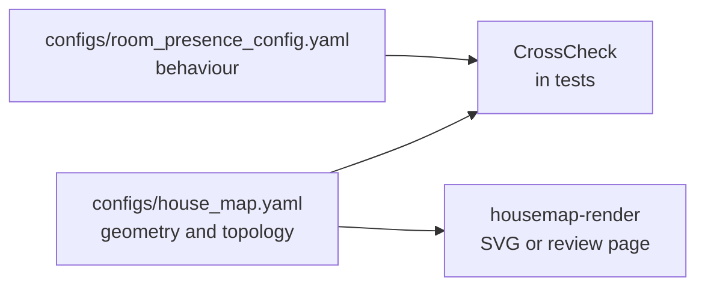

# House Map

**Status:** Built, 2026-11-08, in `internal/housemap/` and `cmd/housemap-render/`. No plugin reads it yet. Tests
check a deployment's map and compare it with the room presence config.

## Summary

The house map is a flat 2D plan of a house, inside and out. It is one hand-edited YAML file. It holds:

- **Spaces:** rooms and outdoor spaces, each a polygon.
- **Doors:** each door names the two spaces it joins.
- **Lines:** fences and other lines that are not spaces.
- **Cameras:** where each camera is, which way it faces, how wide it sees and how far.

The map is the one place for house geometry and topology. Plugins keep behaviour. For example, room presence
keeps idle limits and bed sensors, and reads the map's areas by name.

**This repository holds only the mechanism.** The map of a real house is private deployment data. It lives in
a deployment's `configs/house_map.yaml`. The public repository ships only an example, for the made-up house
of [ROOM_PRESENCE.md](./ROOM_PRESENCE.md).



## Frame

- Units are metres.
- `x` points east and `y` points north. North is up on every drawing.
- `origin` is free text that says where (0, 0) is.
- A heading is in degrees clockwise from north: 0 is north, 90 is east.

A map drawn from a robot vacuum map may record how that map lands in this frame, under `valetudo`:

- `rotation_deg` turns the vacuum map clockwise to north-up.
- `pixel_size_m` is the size of one vacuum map pixel. It must be more than 0.
- `anchor_px` is a vacuum map pixel that lands on the house point `anchor_m`.
- `dock_m` is where the vacuum's dock lands. When a new vacuum map moves the dock, the frame changed.

The three points are `[x, y]` pairs. The package checks their shape and keeps them, but does not use them.

### Who writes which fields

A deployment may regenerate room polygons and interior door spans from a robot vacuum map, with its own
script and the `valetudo` block. Those fields are then machine-written. A traced space says so with
`source: valetudo`; a space a person draws, such as an open-plan area the vacuum does not split out, has
`source: hand` or no `source`. The script redraws only `source: valetudo` spaces, and only the doors between
two of them. Everything else is hand-edited:
outdoor spaces, exterior doors, zones, locks, sensors, lines, cameras and notes. Edit a machine-written field
by hand only if the deployment's script will not overwrite it.

## Schema

```yaml
house_map:
  frame: {units: m, x: east, y: north, origin: "south-west corner of the lounge"}
  valetudo:                       # optional; kept but not used by this package
    rotation_deg: 90
    pixel_size_m: 0.05
    anchor_px: [400, 300]
    anchor_m: [6, 5]
    dock_m: [9, 1]

  spaces:
    kitchen:
      kind: room                  # room | garage | yard | patio | deck | pool | driveway | outbuilding
      area: kitchen               # the room presence area; rooms only, and required for them
      polygon: [[6, 0], [10, 0], [10, 5], [6, 5]]
      source: hand                # hand (default) | valetudo: who writes the polygon
      note: "free text"

  doors:
    kitchen_hall:
      kind: door                  # door | opening | overhead
      connects: [kitchen, hall]   # two different spaces
      span: [[7, 5], [8, 5]]      # the two ends of the doorway; leave out while the door is not placed
      exterior: false             # true for a door to the outside
      zones: {cam_kitchen: kitchen_to_hall, cam_hall: hall_to_kitchen}   # Frigate camera id -> boundary zone
      lock: input_boolean.example_door_unlocked
      sensors: [binary_sensor.example_door_contact]
      note: "free text"

  lines:
    east_fence:
      kind: fence
      line: [[20, -8], [20, 18]]  # at least 2 points

  cameras:
    cam_hall:
      frigate: cam_hall           # Frigate camera id; indoor Frigate cameras only
      at: [4.3, 6.5]
      heading_deg: 90             # middle of the view, clockwise from north
      fov_deg: 90
      range_m: 7
      entities: [binary_sensor.example_person]
      note: "free text"
```

- A **room** is a part of the house that room presence knows. Several rooms may share one area.
- An **opening** has no door leaf, for example the gap between two parts of one open space.
- An **overhead** door is a garage door.
- An **exterior** door joins the house to the outside. One side is a room or the garage. The other side is
  not a room. A door from a room into an attached garage is exterior.
- Spaces may overlap. A pool may sit inside a yard. A point belongs to the smallest space that holds it.

The example map is `internal/housemap/testdata/example_house_map.yaml`.

## Checks

### Validation

`housemap.Load` reads and validates the file. A missing file returns no map and no error, like the room
presence config. Validation collects every problem and sorts them:

- The frame, when given, is metres, x east and y north.
- A `valetudo` block, when given, has a positive `pixel_size_m`, and each of its points has 2 numbers.
- Every space, door and line has a known kind.
- A polygon has at least 3 points. A line has at least 2.
- A room has an area. Other spaces do not.
- A door joins two different spaces that exist. Its span, when given, has 2 points.
- An exterior door joins a room or the garage to a space that is not a room.
- A camera's `fov_deg` is more than 0 and at most 360. Its `heading_deg` is at least 0 and less than 360.
  Its `range_m` is more than 0.

### Cross-check with room presence

`housemap.CrossCheck` compares the map with a room presence config. Both must describe the same house:

- Every room's area is a room presence area.
- Every door zone is a boundary zone between the areas of the door's two spaces, in either direction. The
  zone is read by room presence's naming convention and `zone_overrides`.
- Two different areas joined by a door are linked in room presence, by `neighbors` or by a boundary zone on a
  door between them.
- Every `neighbors` pair in room presence is joined by a door or opening in the map.
- Every area with `leads_outside` has a room with an exterior door.

### Outdoor camera coverage

`Map.CoverageGaps(distance, step)` samples a ring `distance` metres outside the house, about `step` metres
apart. The house is every room and the garage. It returns the sampled points that no outdoor camera covers.

A camera covers a point that is within its range and inside its field of view. Walls and trees are not
modelled. A camera with a Frigate id is indoor, and so is a camera that stands inside a room. Indoor cameras
do not count.

Camera positions are approximate, so coverage gaps are a prompt to look, not a failure.

## How a deployment provides its map

A deployment puts `house_map.yaml` in the workspace-root `configs/` directory, next to
`room_presence_config.yaml`. Its CI then runs three tests in `internal/housemap/`:

- `TestDeploymentMap` fails on any validation problem.
- `TestDeploymentCrossCheck` fails on any cross-check problem. Fix the data before the file goes in.
- `TestDeploymentCoverage` logs the coverage gaps at 3, 5 and 8 m. It never fails.

A public checkout has no map, so these tests skip.

## Drawing the map

`cmd/housemap-render` draws a map. Run it from `homeautomation-go/`:

```bash
# An SVG picture: spaces, doors, fences, camera views, a north arrow and a 5 m scale bar.
go run ./cmd/housemap-render -in ../configs/house_map.yaml -out house_map.svg

# A review page: the plan on a 5 m grid with toggles for names, outdoor spaces and cameras, and side panels
# for doors not yet placed, outdoor cameras, areas and doors with their widths and Frigate zones.
go run ./cmd/housemap-render -format html -in ../configs/house_map.yaml \
    -room-presence ../configs/room_presence_config.yaml -out house_map.html
```

To review a map, render it with `-format html` and publish the file as an artifact. The page is one
self-contained HTML fragment that starts with `<title>`. It loads only Google Fonts. It has light and dark
colours. `-room-presence` is optional: with it, the legend marks the areas no camera sees.

Rooms are tinted by area. Each area's hue comes from a hash of its name, so no area needs a colour setting.
Outdoor spaces are tinted by kind. On the review page, orange bars are exterior doors. Blue bars are doors. Pale bars are
openings.

## Future uses

No plugin reads the map yet. These are the uses it is meant for:

- **Deriving neighbors.** Room presence `neighbors` could come from the map's openings, so they are written
  once.
- **Walking time per door.** The distance from a room to an exterior door gives a time window for an exit.
  A person who leaves room presence's view should reach the door within it.
- **Ordering outdoor sightings.** Outdoor cameras with positions put person sightings in order along a path,
  for example from the driveway to the front door.
- **Picking floodlights.** A sighting's position picks the lights that face it.
