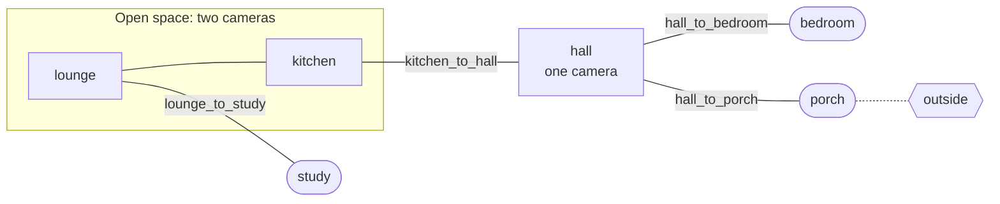
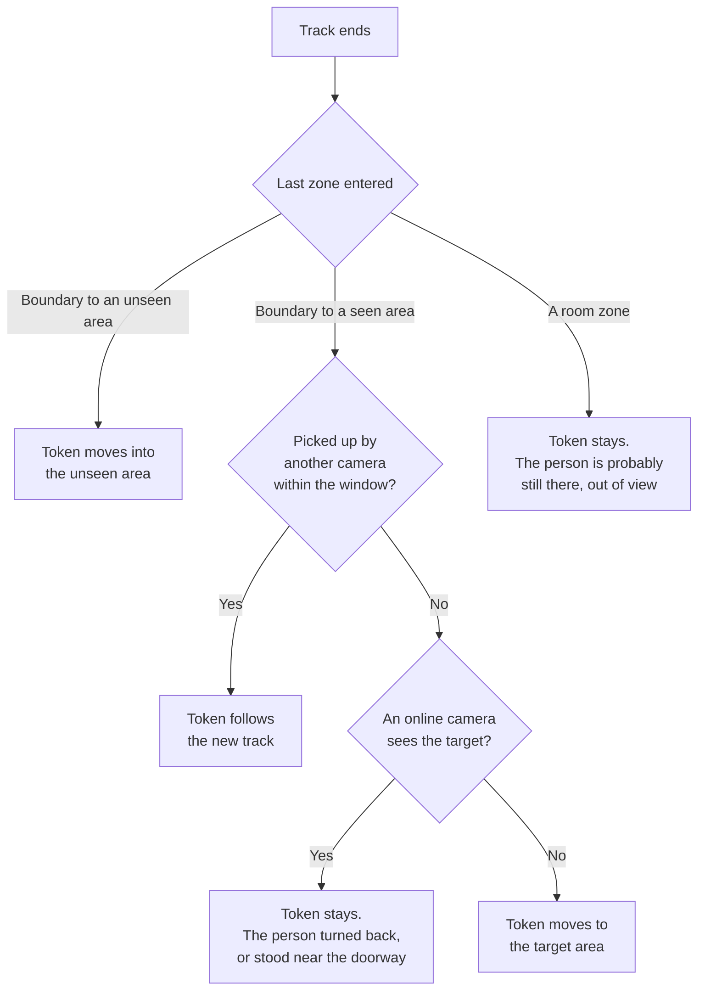

# Room Presence from Frigate Cameras

**Status:** Built, 2026-11-07, in `internal/plugins/roompresence/`. Runs in `log_only` mode until a deployment
switches it to `active`. Not yet wired: the lux controller's use of the entry signal.

## Summary

A new `roompresence` plugin decides which areas of the house have people in them. It reads Frigate's person
events from MQTT and moves anonymous "person tokens" between areas on a map of the house.

- **Seen areas** have a camera that looks at their floor. A token is there when a camera tracks a person there.
- **Unseen areas** have no camera. A token goes in when a person walks into a doorway zone and disappears. It
  comes out when a person reappears at that doorway.
- **Lighting and other plugins read one boolean per area**, for example `isKitchenOccupied`. They do not read
  Frigate.

The plugin starts in `log_only` mode. It computes state and shows it in shadow state, but writes nothing to
Home Assistant.

**This repository holds only the mechanism.** The map of a real house, its camera zones and its configuration
are private deployment data. They are not stored here. Every area name in this document is a made-up example.

## Why tokens, not counts

Frigate only reports a person while it can track them. A walking person's event ends a few seconds after they
enter a camera's view. So "Frigate sees a person in the kitchen right now" is not "someone is in the kitchen".

A token is a placeholder for one person. It stays in its last known area until evidence moves it. Think of a
board game: the piece stays on its square until someone moves it, even when nobody is looking at the board.

Tokens are anonymous, because Frigate's `sub_label` is null without face recognition. Named tracking can come
later from face recognition, phones or bed sensors. The token model has a slot for a name, so it does not need
to change.

## What Frigate gives us

Measured on a live install with Frigate at 5 fps. Higher frame rates shrink some timings.

| Fact | Value | Consequence |
|------|-------|-------------|
| Zone count topic | `frigate/<zone>/person`, summed over cameras | Use events, not counts |
| Event topic | `frigate/events`, `type` new / update / end | Main input |
| Zone a person is in | Bottom-center of the box (the feet) | Draw zones on the floor |
| `current_zones` on `new` | Empty; filled 0.2–0.5 s later | Wait for the first `update` |
| Event `end` after the person stops moving | 1.5–3 s | Ending is not leaving |
| Camera-to-camera hand-off gap | 0.4 s or less | Hand-off window can be short |
| Gap before a returning person is re-tracked | 1.6–3.6 s | Often after the doorway: see rule 4 |
| Direction of travel | Not given; `velocity_angle` is always 0 | Use `entered_zones` order |
| Heartbeat | `frigate/<camera>/status/detect` every 10 s | Detect a dead camera |
| False people | Can repeat at one fixed spot, scores up to 0.9, `stationary=false` | Plausibility check needed |

The Home Assistant Frigate integration is not needed. The plugin reads raw MQTT.

## The map

The geometry of the house, with its rooms, doors and cameras, is in the house map. See
[HOUSE_MAP.md](./HOUSE_MAP.md). Tests check that the two agree.

### Areas

An **area** is the unit of state. It is one room, or several rooms the cameras cannot tell apart. An unseen
area holds every room behind its doorway.

Example house used in the rest of this document:



Square boxes are seen areas. Rounded boxes are unseen areas. Labels on lines are boundary zones.

### Zone naming convention

The plugin reads meaning from Frigate zone names, so a zone change in Frigate needs no code change.

- **Room zone:** the area name, for example `kitchen`. Several cameras may share it when they see the same floor.
- **Boundary zone:** `<area the camera is in>_to_<area beyond the doorway>`, for example `lounge_to_study`.
  It covers the floor just in front of the doorway, on the camera's side.
- **Anything else** is ignored. A zone can be mapped by hand in the config.

A zone name that matches no area is reported in shadow state under `unknownZones`. That makes a typo in Frigate
visible at once.

## How tokens move

The plugin keeps one **track** per Frigate event id. It only acts on a few moments in a track's life.

### When a track starts

A track's first zone is known at its first `update`, not at `new`.

1. **It starts in a boundary zone** such as `lounge_to_study`. A person came out of the unseen area. Move a token
   from `study` to `lounge`. If `study` has no token, still create one in `lounge`. The plugin may have been
   wrong about where that person was.
2. **It starts where another track just ended**, in a neighboring area within the hand-off window. This is the
   same person moving on. Move that token. A track's first message can list several zones, and Frigate's
   order is not always the order the person walked in, so every room and doorway zone in that message
   counts as "where it starts".
3. **It starts in an area that holds a token no track is following.** A person who sat still until Frigate
   lost them has moved again. The track takes over that token.
4. **It starts next to a doorway to an unseen area that holds a token.** A returning person is often
   re-tracked only after they have crossed the boundary zone, so this rule catches those exits. Move a token
   out of that area. "Next to" comes from the config: the unseen area lists the seen area outside its doorway
   under `neighbors`. The rule has no time limit, because nothing Frigate reports marks the moment the
   person came back through the doorway.
5. **None of the above.** The person "appeared from nowhere". Mark the track **unconfirmed**. See
   [False people](#false-people).

Rule 2 is tried first: a hand-off is the most precise evidence of identity. When rules 3 and 4 both match,
the person who disappeared most recently is the one who reappeared: the idle token's last sighting is
compared with the time the other token went through the doorway.

**Straight back through a doorway.** Frigate ends a track 3–5 s after the person leaves view. A person who
steps into an unseen room and comes straight back starts a new track in the same doorway before the old one
has ended. When a new track's first message has a doorway zone to an unseen area, and an active track was
last seen in that doorway (from either side) and has sent nothing for 2 s, the new track takes that track's
token. The old track's end then leaves no token behind in the unseen room. Doorways between two seen areas
are left to rule 2: a person standing near such a doorway would be mistaken for the one walking through.

### While a track runs

A track that enters a room zone of another area moves its token there. Inside an open space this is how a person
goes from `lounge` to `kitchen`. Two cameras that see the same person share one token, because the second track
starts inside the hand-off window.

### When a track ends

The zone the person was last in decides what happened. Frigate often ends a track with no `current_zones`,
and `entered_zones` lists each zone once, in first-entry order. So the plugin uses the current zones, else
the last non-empty current zones, else the last entered zone. A boundary zone wins over the room zone it is
drawn on.



"Token stays" covers a person who sits behind a counter, or who stops moving long enough for Frigate to lose
them. This is where radar sensors failed, so it is the default.

### How a token goes away

Without a rule, a token left behind by a missed exit would keep a room lit forever. Areas may have an **idle
limit** in the config. A token in a seen area expires when no camera sees a person in that area for the limit. A
token in an unseen area expires after that area's own limit. An area that leads outside should have a short
limit. A bedroom may have no `idle_limit` (field absent, parsed as nil `*time.Duration`), cleared instead by
sleep and wake state.

Other evidence also moves tokens:

- **Nobody home** (`isAnyoneHome` false for `nobody_home_delay`, default 5 min): remove every token.
- **A bed presence sensor** listed in the area's `bed_sensors` turns on: make sure the area holds at least
  one token.
- **An exit sensor** listed in the area's `exit_sensors` turns on: the person who just reached the outside
  door went out. See below.
- **An arrival**: an approach sensor, then an exit sensor, then an entry sensor. Someone walked up to the
  door and came in, so the area gets a token. See "Coming in".

#### Leaving the house

No camera watches an unseen area such as a porch, so a person who walks into it and out of the house would
leave a token there until the idle limit. An outdoor camera's person sensor outside that door closes the
gap. List it in the area's `exit_sensors`. Only an unseen area with `leads_outside` may have them: in a seen
area a person who stands still also holds an unheld token, and would be removed.

When an exit sensor turns on (from any state but `on`), it removes one token from the area: the most recent
arrival that no track holds, which arrived at most `exit_window` (default 30 s) before the sensor turned on,
or at most `handoff_window` after it. Frigate ends a track a few seconds after the person leaves view, so
the outdoor camera often sees the person before the token reaches the porch. The tracker keeps the turn-on
for that long and checks again each tick.

The sensor must turn on after the person reaches the door. A visitor already outside when someone walks to
the door to answer it does not remove that person's token. A wrong removal heals itself: a person who comes
back in through the doorway gets a token again under rule 1. A missed exit costs the idle limit, as before.

Sensors that pulse while a person moves, such as a garage door opener's motion sensor, turn on again and
again. Each pulse can remove one more token, so someone who walks into the mudroom to meet a person arriving
in the garage can lose their token until they come back through the doorway.

#### Coming in

Direction comes from where outside a person shows up first. At the door, then farther out: leaving.
Farther out, then at the door: arriving. An area's `exit_sensors` see close to the door. Its
`approach_sensors` see the way up to it, farther out. Its `entry_sensors` are on the door itself: a lock's
unlock helper or a contact sensor.

The order the sensors turn on does not show direction alone. A camera farther out often also sees the door,
so a person leaving turns on the approach sensor and the exit sensor together, within a second or so. So:

1. An approach sensor turns on.
2. An exit sensor turns on at least `approach_lead` (default 3 s) and at most `arrival_window` (default 60 s)
   later. This is someone walking up. That exit sensor turn-on does not remove a token.
3. An entry sensor turns on at most `arrival_window` after that. The person opened or unlocked the door, so
   the area gets a token, and the area counts as entered. The camera inside then moves that token in under
   rule 1.

A visitor who walks up and stays outside never turns on an entry sensor, so gets no token. Someone inside
unlocking the door to leave turns the entry sensor on before the exit sensor, so it does nothing. An exit
sensor with no recent approach, or one that turned on with it, is handled as under "Leaving the house".

A person leaving while someone else was farther out a few seconds earlier looks like an arrival, so that
exit is missed until the idle limit. `approach_sensors` and `entry_sensors` go together, and only with
`exit_sensors`. An approach sensor cannot also be an exit or entry sensor of the same area.

The number of people home never removes a token. Guests are not counted, and when the count is wrong the
token removed can be the wrong person's. A token left by a missed exit expires under its area's idle limit.

### False people

Frigate can report a person at a fixed spot where nobody is, with a high score. Nothing in the event marks it as
false.

The map catches it. A real person cannot appear in the middle of a seen room without walking in. So a track that
starts by rule 5 is **unconfirmed**. It turns into a token only when one of these happens:

- It reaches a boundary zone or another area. Real people go somewhere.
- It has entered at least two distinct zones within the track. Real false positives are stationary.
- The house has fewer tokens than people home, for example right after the plugin starts.

An unconfirmed track does not turn on lights. A real entry almost always comes with a hand-off, so this adds no
delay to normal room entry.

An object mask in Frigate is still the right fix for a known false spot. This rule catches the ones nobody has
found yet.

### Camera failure

When a camera's heartbeat stops for 30 s, its areas are marked **unknown**. Tokens in them freeze and do not
expire. Lighting then sees the last state, not a sudden "empty room". Shadow state reports which camera is down.

When the heartbeat returns, affected areas leave the unknown state. Frozen tokens resume expiry from where they
paused — their last-seen clock does not reset. A token that was 50 minutes through a 1-hour idle limit when the
camera failed expires 10 minutes after recovery, not 1 hour later.

## Outputs

The config maps output variables to areas. A variable is true when any of its areas holds a token. The first
one is `isKitchenOccupied`, which today is fed by a Home Assistant automation from an mmWave radar.

The plugin also reports, in shadow state only (query in real time with `curl /api/shadow/roompresence`):

- Tokens: area, when last seen, which camera, confirmed or not, and why each one last moved.
- Recent tracks with their zone order.
- Camera health.
- Zones that match no area.

A short **entry signal** goes with each occupied change: "a token just arrived from outside the area". The lux
controller can use it for a fast fade-in on room entry. A token that only expired, or the plugin starting up,
gives the slow fade. The entry signal is a callback, not a state variable: `manager.go` calls a registered
`OnEntry(area string)` function. The lux plugin registers this callback at startup, alongside its other
subscriptions.

When the plugin starts writing a variable, disable any Home Assistant automation that also writes it. Otherwise
the two fight.

## Implementation

### Reading MQTT through Home Assistant

The plugin subscribes with the Home Assistant WebSocket command `mqtt/subscribe` on the existing connection. It
needs an admin token, which the app already has. It needs no broker credentials and no MQTT library.

**Prerequisite:** The Home Assistant MQTT integration must be installed and connected to the broker. Without it,
`mqtt/subscribe` returns an error and the plugin falls back to unconfigured mode (logs the reason, writes
nothing).

The HA client needs one new method, `SubscribeMQTT(topic string, handler MQTTHandler)`. It follows
`SubscribeEvents` in `internal/ha/events.go`: it registers before connect, subscribes again after every
reconnect, and dispatches in order on one queue. One difference: MQTT messages arrive as events tagged by
subscription id, not by `event_type`. `handleEvent` therefore needs a lookup from subscription id to topic.

After a reconnect the plugin does not trust its open tracks. It ends them as if Frigate had ended them, so the
normal "token stays" rule applies.

### Plugin shape

A standard plugin in `internal/plugins/roompresence/`, following [SHADOW_STATE.md](../reference/SHADOW_STATE.md):

- `config.go`: loads the room presence config.
- `tracker.go`: tracks, tokens and the rules above. Pure logic, with a fake clock and no I/O, so tests can replay
  MQTT logs.
- `manager.go`: MQTT subscription, timers, state writes and shadow state.

With no config file, the plugin starts, records that it is unconfigured, and does nothing else. That is the
normal state for a public checkout.

### Configuration

The real config is private deployment data. The public repo ships only an example, for the example house above:

The example is `internal/plugins/roompresence/testdata/example_config.yaml`:

```yaml
room_presence:
  mode: log_only              # log_only | active
  handoff_window: 5s
  camera_heartbeat_timeout: 30s
  nobody_home_delay: 5m
  exit_window: 30s
  arrival_window: 60s         # optional
  approach_lead: 3s           # optional
  areas:
    lounge:  { seen: true,  idle_limit: 20m, neighbors: [kitchen] }
    kitchen: { seen: true,  idle_limit: 20m }
    hall:    { seen: true,  idle_limit: 5m }
    study:   { seen: false, idle_limit: 3h, neighbors: [lounge] }
    bedroom: { seen: false, neighbors: [hall], bed_sensors: [binary_sensor.example_bed_presence] }
    porch:   { seen: false, idle_limit: 10m, leads_outside: true, neighbors: [hall],
               exit_sensors: [binary_sensor.example_yard_person],
               approach_sensors: [binary_sensor.example_street_person],
               entry_sensors: [input_boolean.example_porch_door_unlocked] }
  outputs:                    # only written in active mode
    isKitchenOccupied: [kitchen]
  zone_overrides:             # zone name -> area, <area>_to_<area>, or ignore
    hall_doormat: hall
```

- `neighbors` (symmetric) are areas a person walks between without a boundary zone: parts of one open space,
  and the seen area outside an unseen area's doorway. Hand-offs and rule 4 use it.
- `exit_sensors` are binary sensors outside an unseen area's outside door. See "Leaving the house".
- `approach_sensors` see the way up to that door, farther out, and `entry_sensors` are on the door. See
  "Coming in".
- An area with no `idle_limit` never expires. Nobody-home and the people count still remove its tokens.
- `cameras` (optional) maps a camera to the areas it sees. The plugin also learns this from the zones each
  camera reports. It decides which areas freeze when a camera stops.
- A missing file leaves the plugin unconfigured. An invalid file does too, and shadow state gives the error.

Adding a Frigate zone that follows the convention needs no config change. Adding an area needs one line.

## Rollout

1. **Log only.** Run the plugin in production in `log_only` mode. Compare tokens with real life for a few days,
   and tune windows and idle limits. Lighting does not change.
2. **Kitchen.** Switch to `active` for `isKitchenOccupied` only, and disable the old automation that writes it.
3. **More areas.** Add outputs and lighting rules area by area.
4. **Fast fade.** Wire the entry signal into lux control.

## Logs

Production keeps Info and above, so the plugin logs every real change at Info. Tune from these lines later.
One line per change. A token whose `lastSeen` only moves logs nothing.

- `Room presence token created`: `token`, `area`, `reason`, `camera`.
- `Room presence token moved`: `token`, `from_area`, `to_area`, `reason`, `camera`.
- `Room presence token removed`: `token`, `area`, `reason` (the removal reason).
- `Room presence output changed`: `key`, `value`, `previous` (absent on the first value), `mode`, and
  `written`. `written` is true only in `active` mode without read-only. In `log_only` it shows what the
  output would have been. The first value of an output is logged only when it is true.
- `Room presence output`: an output was written to Home Assistant (active mode).
- `Person entered area` stays at Debug. It is the entry signal for lux control, not a state change.

## Testing

- **Replay tests.** Each test replays a log of Frigate MQTT messages through the tracker with a fake clock. It
  asserts where each token is after each leg of a known walk. The public tests use a synthetic log for the
  example house. Captures from a real house stay with the private config: a deployment puts
  `room_presence_config.yaml` and `room_presence_fixtures/<name>.jsonl` with `<name>.expect.yaml` in the
  workspace-root `configs/` directory, and `TestDeploymentConfig` and `TestDeploymentReplays` check them. A log
  has one `{"t": <unix seconds>, "topic": ..., "payload": ...}` object per line. Expectations list
  checkpoints (`after` seconds, `occupied`, `empty`) and optionally `unknown_zones`. A log can also hold
  Home Assistant state changes of bed, exit, approach and entry sensors, with topic `ha/state` and payload
  `{"entity_id": ..., "from": ..., "to": ...}`.
- **Rule tests.** Table-driven tests for each start, end and expiry rule.
- **User stories**, in `test/integration/scenario_roompresence_test.go`, in the GIVEN/WHEN/THEN form. For
  example:
  - "When I sit still behind the counter for 10 minutes, the kitchen lights stay on."
  - "When I walk into the study, the lounge does not go dark while someone else is on the couch."
  - "A false person in the kitchen does not turn the kitchen lights on."
  - "When a camera goes offline, its rooms' lights do not turn off."
