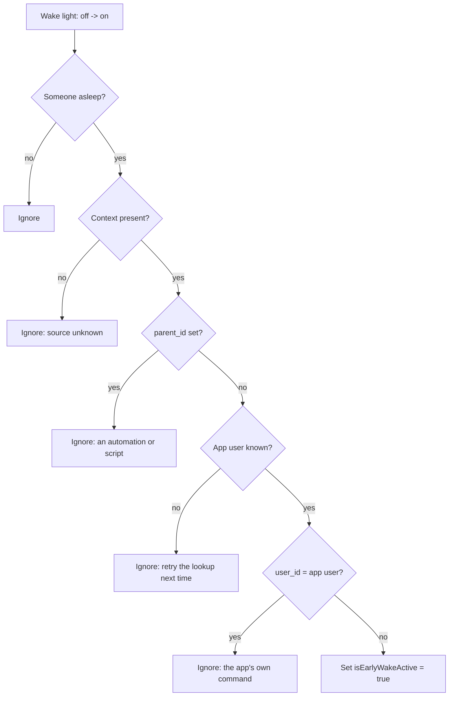
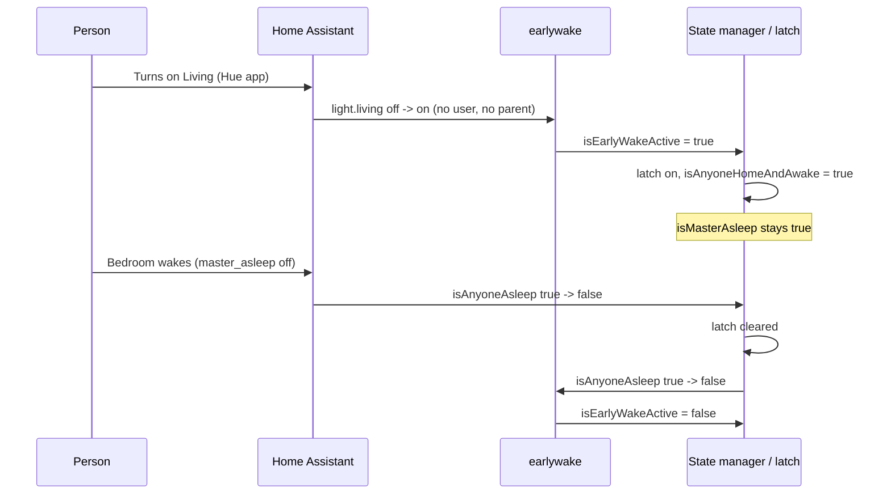
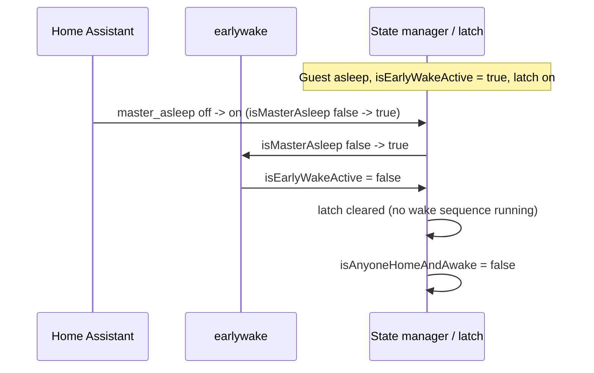

# Early Wake

Someone gets up early while a bedroom (the primary suite or the guest room) still sleeps. The house
wakes up with them: common-area lights follow their awake rules, morning music plays on the common
speakers, and announcements can be heard. The bedroom keeps sleeping: its lights are untouched and
its speaker keeps the rain sounds.

The signal is `isEarlyWakeActive` (`input_boolean.early_wake_active`). It shows on the dashboard and
can be turned on there by hand.

## What turns it on

| Source | Plugin | Condition |
|--------|--------|-----------|
| A person turns on a wake light | `earlywake` | Off → on, someone asleep, the change was made by hand (below) |
| A Pico up-press | `picos` | The target has `wakes_house: true`, the press turns it on from off, someone asleep |
| The dashboard | - | `input_boolean.early_wake_active` turned on by hand |

Wake lights are listed in `configs/early_wake_config.yaml`: Living, Living Accent, Sitting, Sitting
Chandelier, Kitchen cans and under-cabinet, and the Breakfast Nook cans. The pantry is left out: it
is the night path to the bedroom and the nursery. The `kitchen` and `living` Pico targets wake the
house; the pantry and back hall targets never do.

### "By hand"

Home Assistant attaches a context to every state change. At startup the plugin asks Home Assistant
which user owns the app's token (`auth/current_user`).



An empty `user_id` (the Hue app, a wall switch, HomeKit, voice) or another user's ID (the HA
dashboard) counts as a person. The app's own commands (lux control, scenes, Picos, path lights)
carry the app's user ID and never count. A brightness change on a light that is already on is not a
turn-on.

## What it does

`isEarlyWakeActive` turning on (or being on at startup) activates the wake sequence latch
(`internal/state/wake_sequence_latch.go`). The latch holds `isAnyoneHomeAndAwake = true` until early wake
ends (below). It never sets `isWakeSequenceActive`, so the bedroom wake sequence does
not start.

| Area | Effect |
|------|--------|
| Lighting | Common-area rooms gate on `isAnyoneHomeAndAwake`, so they wake. Primary Suite lighting skips while `isMasterAsleep`. |
| Music | The `morning` zone gains a trigger group: `isEarlyWakeActive=true` + `isAnyoneHome=true`, any day phase (before 06:00 or dawn the phase is still `night`). The `sleep` zone keeps Primary Bed; Primary Bed is excluded from `morning` while `isMasterAsleep`. |
| Announcements | A deferable announcement that sleep would suppress plays on the requested speakers minus `bedroom_speakers` (`configs/notification_config.yaml`). If none remain, or `bedroom_speakers` is empty, it stays suppressed. Urgent announcements are unchanged. |
| Security (private) | Lockdown turns off. A person detected outside raises no alert and flashes no lights. |

## What turns it off

The `earlywake` plugin clears `isEarlyWakeActive` when everyone is up or at bedtime:

| Edge | Why |
|------|-----|
| `isAnyoneAsleep` true → false | A normal wake: everyone is up. |
| `isMasterAsleep` false → true | Bedtime (`input_boolean.master_asleep` on). A guest can count as asleep all day, and early wake can be turned on from the dashboard while everyone is awake. In both cases `isAnyoneAsleep` never falls, so without this clear early wake would carry into the night. |

In read-only mode the plugin only logs that it would clear early wake.

The latch clears when `isAnyoneAsleep` falls, and also when `isEarlyWakeActive` falls (true → false),
so turning early wake off, by the plugin or from the dashboard, releases the house. The exception is
an alarm wake sequence in progress: while `isWakeSequenceActive` is true the wake sequence owns the
latch, and the latch stays until `isAnyoneAsleep` falls. An idle timeout back to sleep is planned
for later.



At bedtime, while a guest still sleeps:



## Night paths do not wake the house

The guest's Pico ("Hallway Between Bedrooms") has `path_lights`: an up-press while the house is asleep
also turns on the two north living cans at 5% and 2200 K, if they are off. See
[PICO_BUTTONS.md](./PICO_BUTTONS.md). Path lights are app commands and never set
`isEarlyWakeActive`.

## Debugging

```bash
curl -s https://home-automation.featherback-mermaid.ts.net/api/shadow/earlywake | jq
scripts/loki-query.sh '{service="home-automation"} |= "early wake"' 12h
```

`outputs.lastLightChange` shows the last off → on of a wake light, its context, and the decision.
`outputs.appUserId` is empty if Home Assistant has not told the app its user yet; detection is
paused until it does.
