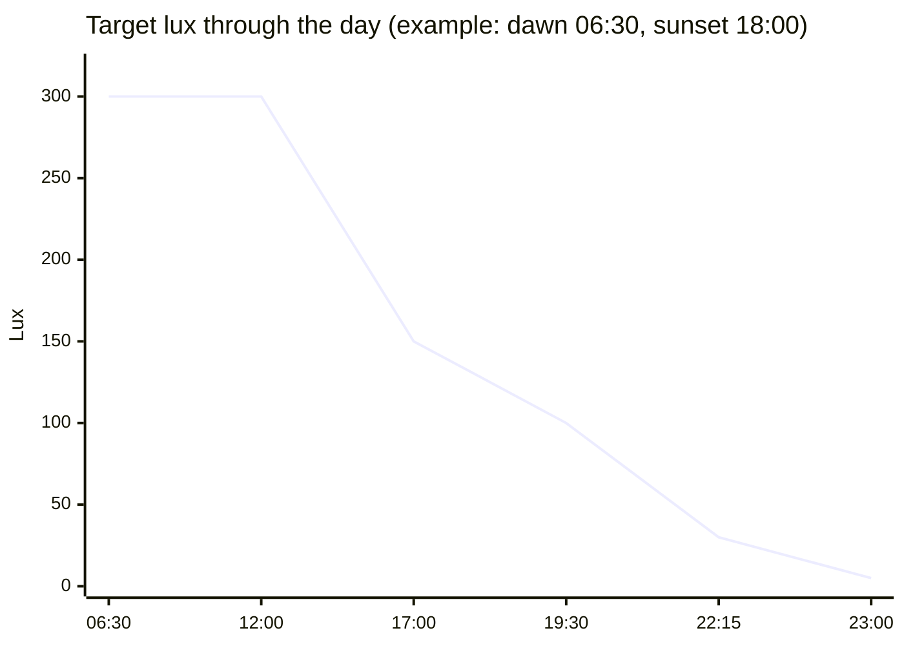
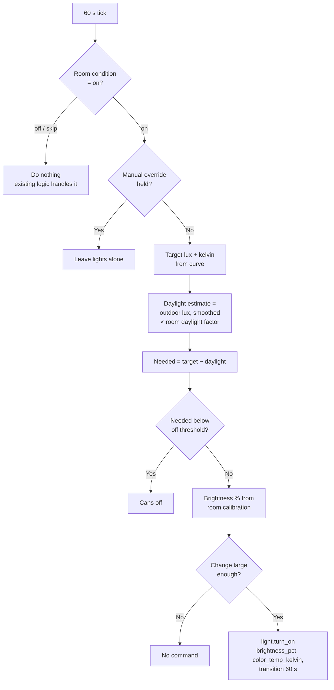

# Lux-Target Lighting (Design)

**Status:** Rollout steps 1 to 3 and 5 are built. Step 4 is done for the Kitchen, the Pantry and the two chandeliers. The Living Room, Kitchen, Pantry, Front Foyer and Front Room ship in `active` mode. Their `daylight_factor` and `calibration` were measured on 2026-10-30 with a phone app, in daylight, so they are rough and temporary until real lux sensors arrive. `lux_scale` is still a guess. See "Implementation notes" at the end.

## Summary

The ceiling cans stop recalling a Hue scene for each day phase. Instead, each room follows a curve of target brightness (lux) and color temperature (kelvin) that changes smoothly through the day. Every minute, the lighting plugin estimates how much daylight is in the room. The cans supply only the difference. On a sunny day they dim or switch off. On a cloudy day they brighten.

Accent lights keep their per-phase scenes. The Kitchen and Pantry under-cabinet task strips no longer use scenes. They follow their room's cans as "follower lights" (see "Which lights are controlled").

A manual change to a room's lights now holds until that room goes off and on again, until everyone is asleep, or until reset runs. Day phase changes no longer undo it. This fixes the evening problem, where someone turns the lights up and the system turns them back down at `dusk`, `winddown` and `night`.

## Goals

- Hold a target indoor lux in each controlled room, using daylight first.
- Follow a smooth curve through the day, not steps at phase changes.
- Follow circadian guidance: bright and cool by day, dim and warm in the evening, dark during sleep.
- Accept manual changes and keep them.

## Not in scope

- Indoor lux sensors. The Apollo MSR-2 sensors have been offline since 2026-10-14. The design uses an outdoor estimate only. The control loop has one input for daylight, so an indoor sensor can replace the estimate later without a redesign.
- Presence-based evening transitions. Interior presence tracking comes later. The curve will then be able to move with behavior (for example, "people left the kitchen after dinner") and not only with the clock. This design keeps the curve position as one input, so presence can drive it later.
- Changes to the primary suite. The `sleephygiene` plugin owns those lights during sleep and wake.

## Which lights are controlled

Each room splits its lights into three roles.

| Role | Controlled by | Examples |
|------|---------------|----------|
| Cans (ambient) | Lux target. White light only, brightness and kelvin. | `light.living_cans`, `light.kitchen_cans`, `light.pantry_cans`, `light.front_foyer_chandelier`, `light.front_room_chandelier` (brightness only) |
| Accent | Per-phase Hue scene, as today | `light.living_accent` (TV, window wall) |
| Task (follower) | Follows the cans: `floor_pct + gain * cans %`, brightness only | `light.kitchen_main_lights` (Kitchen Under Cabinet), `light.pantry_under_cabinet` |
| Task (scene) | Companion scene, as today. No room uses it now. | none |

Controlled rooms: **Living Room** (`light.living_cans`), **Kitchen** (`light.kitchen_cans`, 7 cans) and **Pantry** (`light.pantry_cans`, 8 cans). **Front Foyer** (`light.front_foyer_chandelier`) and **Front Room** (`light.front_room_chandelier`) are Lutron Diva dimmers: brightness only, no color temperature. Next: Sitting Room, N Office.

The Pantry has no occupancy sensor and no Hue scene group. It is its own room entry with the Kitchen's `conditions` copied, so it turns on when the Kitchen is occupied and off when nobody is home and awake.

The two chandeliers also have no scene group and no area. They are on whenever someone is home and awake (`isAnyoneHomeAndAwake`), with no occupancy sensor. Their room entries set `color_temp: false`, so the plugin sends only `brightness_pct` and `transition`, never `color_temp_kelvin`. It records no kelvin in shadow state (`targetKelvin` is 0) and compares only brightness when it looks for manual changes.

The room's existing `conditions` (presence, TV, sleep, wake sequence) still decide `on`, `off` or `skip`. The lux target only decides *how bright and how warm* the cans are when the room is `on`.

## Target curve

The curve is a list of points. Each point is tied to a sun event or a schedule time from `schedule_config.yaml`. Between two points, the target slides smoothly. Lux slides on a log scale, because the eye sees brightness roughly logarithmically. Kelvin slides in mired (one million divided by kelvin), because equal mired steps look like equal color steps.

| Point | Anchor | Target lux | Kelvin |
|-------|--------|-----------:|-------:|
| Dawn | sun `dawn` | 300 | 4000 |
| Noon | sun `noon` | 300 | 4000 |
| Golden hour | sun `goldenHour` | 150 | 3000 |
| Dusk (after dinner) | schedule `dusk` | 100 | 3000 |
| Wind-down | schedule `winddown` | 30 | 3000 |
| Night, awake | schedule `night` | 5 | 3000 |
| Asleep | `isEveryoneAsleep` | 0 (off) | — |

The kelvin range is 3000 K to 4000 K on purpose. The cans are fully tunable, but the other lights in these rooms are fixed at 3000 K, and the under-cabinet strips fade between 3000 K and 4000 K. Matching that range keeps the room one color. At night, the dimming does the circadian work: color temperature has a smaller effect than brightness.

The 100 → 30 slide from `dusk` to `winddown` is a compromise. It keeps the room comfortable after dinner. It reaches the circadian limit (about 30 lux at warm color) before bed.

Each room can scale the whole curve. For example, a hallway might use `lux_scale: 0.5`.



## Control loop

Every 60 seconds, for each controlled room that is `on`:



### Daylight estimate

`sensor.weather_station_illuminance` reports outdoor lux. Each room has a `daylight_factor`, the share of outdoor light that reaches the room's working height. Typical homes fall between 0.5% and 5%.

The plugin smooths the outdoor reading over about 5 minutes. A passing cloud then does not make the cans pump up and down.

Known limits of an outdoor estimate:
- Blinds and curtains are invisible to it. Closed blinds make the room darker than the estimate, so the cans stay too dim. A person can override.
- Low sun shining straight in a window makes the room brighter than the estimate.
- A sensor fault or an unavailable reading must not leave the room dark. If the reading is missing or stale, the plugin treats daylight as 0 and lights the room to the full target.

### From lux to brightness

Each room has a short calibration table: the lux the cans give at a few brightness levels, measured at night with no daylight. Hue dimming is not linear, so three points (for example 25%, 50%, 100%) are better than one. The plugin interpolates between them. Below the first point it interpolates from 0% = 0 lux, and above the last point it gives 100%. A table needs no 100% point.

### Avoiding flicker and churn

- **Off threshold with hysteresis.** The cans turn off when the needed lux falls below the lux at 1% brightness. They turn back on only when it rises 50% above that level.
- **Minimum change.** The plugin sends a command only when brightness moves by at least 3 percentage points, or kelvin by at least 100 K.
- **Long transitions.** Each command uses a 60-second transition, so changes are not visible as steps.
- **Slew limit.** A lit room never moves more than 25 percentage points or 400 K from the last command in one tick (`maxBrightnessStep`, `maxKelvinStep`). A bigger gap closes over several ticks. The minimum-change rule applies after the limit. The 25-point step was judged invisible over a 60-second fade; the 400 K step is a conservative, untested guess. Turning on from dark (the fast 5-second profile, kept quick for room entry) and turning off are not limited. Follower strips follow the limited cans value.
- **Restart and reset fade.** The plugin forgets its last command on restart and on reset. If the cans are already on, it starts from their reported brightness and color temperature, so the room fades with the normal 60-second transition and the slew limit instead of jumping to the target. A room that is really off, or whose cans report no brightness, still turns on with the short transition. A follower strip that is already on also keeps the long transition.
- **Presence arrivals.** When a room turns on because someone arrived, the first command uses the existing short transition (`maxReturnHomeTransition`). Long transitions on lights that are off can fail on the Hue bridge.

## Manual override

### What counts as a manual change

A manual change is any change to a controlled light that this plugin did not command. Examples: the Hue app, a Hue dimmer switch, the Home Assistant UI, or a voice assistant.

The plugin remembers the last brightness and kelvin it sent to each room. When Home Assistant reports a state for that room's cans, the plugin compares it with the commanded values:

- During the transition window of its own command, the plugin ignores reports. Hue reports intermediate values while it fades.
- After the window, a difference larger than a tolerance (about 5% brightness or 150 K) counts as a manual change.
- A change made through Home Assistant by another user also counts. The state's `context.user_id` names who made it. The plugin's own calls carry the plugin's user ID.

Other plugins that drive lights (`sleephygiene`, the music light show) are excluded by their user ID or because the room is in `skip`.

### What a manual change does

The room enters **held** state. While held:
- The lux loop does not touch the cans.
- Day phase and sun event changes do not re-fire the room's accent scene either. The person set the room the way they want it, and that covers the whole room.
- The existing `off` conditions still apply. If everyone leaves, the room still turns off.

### What clears the hold

| Event | Why |
|-------|-----|
| The room turns off and then on again, by any cause | A new "session" in the room. |
| `isEveryoneAsleep` becomes true | The day is over. |
| `isAnyoneHome` becomes false | The house is empty. |
| `reset` runs | Reset acts as if every room's lights went off and on again. The last command is forgotten, so the next tick starts from the cans' reported state and fades to fresh values. |

A day phase change does **not** clear the hold. This replaces today's behavior, where every phase change re-fires every room.

### Note on existing documentation

`LIGHTING_CONTROL.md` documents the same per-room hold behavior. Rooms in `active` mode use it. Before lux-target
lighting, the code (`manager.go`) had no override detection.

## Interaction with existing behavior

| Existing feature | Behavior with lux targets |
|------------------|---------------------------|
| Room `conditions` | Unchanged. They decide on, off or skip. |
| TV playing (`skip`) | Unchanged. Hue Sync owns the lights. |
| Primary suite, `sleephygiene` | Not converted. Sleep and wake stay as they are. |
| `increase_brightness_if_true: isHaveGuests` | Multiplies the target lux by a factor (proposed 1.5). |
| `skip_reactivation_when_on` (Kitchen) | Replaced by the manual hold, which covers the same need more generally. |
| `READ_ONLY=true` | Logs what it would send and records the decision in shadow state. |

## Configuration sketch

```yaml
lux_curve:
  points:
    - { anchor: sun.dawn,          lux: 300, kelvin: 4000 }
    - { anchor: sun.noon,          lux: 300, kelvin: 4000 }
    - { anchor: sun.goldenHour,    lux: 150, kelvin: 3000 }
    - { anchor: schedule.dusk,     lux: 100, kelvin: 3000 }
    - { anchor: schedule.winddown, lux: 30,  kelvin: 3000 }
    - { anchor: schedule.night,    lux: 5,   kelvin: 3000 }
  outdoor_sensor: sensor.weather_station_illuminance
  smoothing_minutes: 5
  tick_seconds: 60

rooms:
  - hue_group: Living Room
    # ... existing conditions unchanged ...
    lux_control:
      mode: log_only            # log_only | active
      cans: light.living_cans
      accent_scene_group: Main Living Accent
      daylight_factor: 0.02     # measured during calibration
      lux_scale: 1.0
      calibration:              # lux at working height, cans only, at night
        # WARNING: Leaving these at zero makes the cans ignore daylight and never dim in sunlight.
        - { brightness_pct: 25,  lux: 0 } # TODO: fill in from calibration
        - { brightness_pct: 50,  lux: 0 } # TODO: fill in from calibration
        - { brightness_pct: 100, lux: 0 } # TODO: fill in from calibration
```

## Shadow state

`/api/shadow/lighting` gains a per-room `luxControl` block:

| Field | Meaning |
|-------|---------|
| `curvePoint` | The two points the curve is between, and the position |
| `targetLux`, `targetKelvin` | Target from the curve |
| `outdoorLux`, `daylightEstimate` | Smoothed outdoor reading, and the room estimate |
| `neededLux`, `brightnessPct`, `goalBrightnessPct` | What the cans must supply, the brightness last commanded (after the slew limit), and the brightness the target asks for |
| `held`, `heldSince`, `heldReason` | Manual override state |
| `followers` | Per follower light: `pct` (last commanded percent, 0 = off) and `held` (a person changed that strip) |
| `decision` | Why the last tick did or did not send a command |

## Calibration (once per room)

Aim for ±20% to ±30%, not more. The eye reads brightness on a log scale, so a small error is hard to see.

**Tools.** A handheld lux meter (about $15 to $30) is the most reliable. An Android phone app is good enough, because Android gives apps the light sensor. iPhone apps estimate from the camera and are rougher.

**1. Calibration table (at night, no daylight)**

1. Turn off every other light, including accents and the TV. Close the blinds.
2. Set the cans to 4000 K at 25%, 50% and 100% brightness.
3. Hold the sensor flat and facing up, at table or sofa-seat height.
4. Read three or four spots where people sit. Average them. Record one lux value for each brightness.

**2. `daylight_factor` (bright overcast day, cans off)**

1. Read the indoor lux where people sit. At the same moment, read `sensor.weather_station_illuminance` in Home Assistant.
2. Divide indoor by outdoor.
3. Repeat three or four times and average. Typical values are 0.005 to 0.05.

Without a meter, tune `daylight_factor` by eye. In `log_only`, shadow state shows when the cans would switch off. Adjust the number until that matches when the room feels bright enough on a sunny day.

**3. Put the values in the room's config**, then set `calibrated: true`.

**Check that the cans can reach the target.** If 100% gives far less than the 300 lux target, the cans sit at 100% all day and the curve has no effect. Set `lux_scale` below 1 so the curve fits what the cans can do.

The values that ship in `hue_config.yaml` are rough guesses. Replace them with measurements.

Indoor sensors, when they come back, read light at the ceiling or wall, not at the working height. They would need the same comparison against a hand-held meter.

## Hue setup

**Follower lights (under-cabinet strips).** A room's `lux_control` may list `follower_lights`. Each tick, when the loop commands the cans, it also sends each follower `brightness_pct = clamp(floor_pct + gain * cans_pct, 1, 100)`, with no color temperature and the same transition (a strip that was dark gets the short return transition). The strip is off whenever the cans are off, because daylight covers the target or the room is off. The minimum-step rule uses the strip's own last-sent value. `floor_pct` and `gain` are per-strip, user-chosen starting guesses. Tune them later.

| Strip | `floor_pct` / `gain` | Cans 100% | Cans 50% | Cans 10% |
|-------|---------------------|----------:|---------:|---------:|
| Kitchen Under Cabinet (`light.kitchen_main_lights`), dim-to-warm | 20 / 0.8 | 100% | 60% | 28% |
| Pantry under cabinet (`light.pantry_under_cabinet`), fixed 3000 K | 50 / 0.5 | 100% | 75% | 55% |

The Kitchen strip is dim-to-warm: its color temperature falls as it dims, and the evening target is near 3000 K, which needs real dimming. Do not raise its floor without checking the warmth. The Pantry strip has a fixed color, so it stays brighter and flatter.

A manual change to a strip holds that strip only. The room and its cans keep following the curve. The strip is left alone until the same events that end a room hold: the room goes off and on, everyone is asleep, nobody is home, or reset. The strip's rule for what counts as manual matches brightness-only lights: kelvin is ignored, and reports during the transition window are the plugin's own change.

The cans stay in their Hue rooms. A Hue light belongs to one room but can sit in many zones, so the plugin drives cans and accents through separate zones.

| Room | Hue groups | Hue work |
|------|------------|----------|
| Living Room | Room = 4 cans + TV. Zones `Living Cans` and `Main Living Accent` (couch, floor gradient, kids hall, TV). | Create six scenes on the `Main Living Accent` zone: `morning`, `day`, `sunset`, `dusk`, `winddown`, `night`. This gives `scene.main_living_accent_<phase>`. |
| Kitchen | Room = 7 cans only. Under-cabinet is a separate Home Assistant light. | None. The plugin stops recalling `scene.kitchen_<phase>` and no longer recalls `scene.kitchen_under_cabinet_<phase>`. The six under-cabinet scenes stay in Home Assistant, unused. The strip follows the cans. |
| Pantry | 8 cans. No scenes are used. The under-cabinet strip follows the cans. | None. The room entry has no `accent_scene_group` and no `hass_area_id`. Turn-off targets `light.pantry_cans` directly. |
| Front Foyer, Front Room | One Lutron Diva chandelier each. Brightness only. No scenes are used. | None. Same as the Pantry: no `accent_scene_group`, no `hass_area_id`, `color_temp: false`. Turn-off targets the chandelier entity directly. |
| Sitting Room, N Office | Lamps, candles, a floor gradient. No cans. | None. They stay on scenes. |
| Main Living Space (zone) | Kitchen cans, living cans and accents together | None. Its scenes reset the cans, so avoid recalling them by hand. |

Keep the old `scene.living_room_<phase>` scenes until the Living Room runs in `active` mode. In `log_only` mode the plugin still recalls them, and they allow a rollback.

Turn off any Hue-bridge automation on a controlled room: the "Natural light" schedule, timers, routines, and buttons set to "time-based light". Home Assistant cannot see these, and they would fight the lux loop. Plain button presses are fine; they count as manual changes.

## Rollout

1. Build the curve, the loop, the hold logic and shadow state. Living Room runs in `log_only`.
2. Calibrate the Living Room. Watch shadow state for a few days, sunny and cloudy.
3. Switch the Living Room to `active`.
4. Add the Kitchen, Pantry, Sitting Room and N Office one at a time. The Kitchen, the Pantry, the Front Foyer and the Front Room are done (phone-app calibration, `active`). Sitting Room and N Office remain. The Kitchen and Pantry under-cabinet strips now follow the cans instead of using scenes (step 4 follow-up).
5. Turn on the manual hold for every room, including rooms still on scenes. This fixes the evening problem everywhere, even before every room has lux control.

Step 5 does not depend on the lux loop. It could ship first.

## Implementation notes

What the code does, where it differs from the text above, and what is left.

- **Code:** `luxcurve.go` (curve and math), `luxcontrol.go` (loop, hold, shadow state), `luxanchors.go` (sun and schedule times), all in `internal/plugins/lighting/`.
- **Sun times are for the local calendar day.** The sun calculator asks suncalc for local noon of the local date, and the anchors reload when the local date changes. suncalc's own day rolls over at solar midnight (about 01:30 local here), so asking with "now" returned yesterday's sun times from 00:00 to about 01:30 and lifted the target to about 150 lux (fixed 2026-10-31). The target must never rise between 22:00 and sunrise.
- **Living Room is `active`.** `daylight_factor` and `calibration` in `hue_config.yaml` come from a rough phone-app measurement (2026-10-30). `lux_scale` is a guess. `calibrated: true` only lets the config load, because the loader refuses `mode: active` without it. Replace the guesses with measurements. `log_only` remains for testing a new room.
- **Kitchen and Pantry are `active`.** Measured 2026-10-30 evening with an iPhone lux app (rough, about +/-30%) at 4000 K, with about 7,500 lux outside. Cans-only lux is the reading minus the room's cans-off baseline. These numbers are temporary until real lux sensors arrive. `lux_scale: 0.5` is a guess for both rooms, copied from the Living Room.

  | Room | Cans-off baseline | Readings at 25 / 50 / 100% | Cans-only at 25 / 50 / 100% | `daylight_factor` |
  |------|------------------:|---------------------------:|----------------------------:|------------------:|
  | Living Room | 24 | not recorded | 3 / 9 / 36 | 0.0025 |
  | Kitchen | 12 | 16 / 26 / 66 | 4 / 14 / 54 | 0.0016 (12 / 7,500) |
  | Pantry | 26 | 37 / 67 / 188 | 11 / 41 / 162 | 0.0034 (26 / 7,600) |
- **Chandeliers are `active` and brightness only.** Front Foyer (`light.front_foyer_chandelier`) and Front Room (`light.front_room_chandelier`) are Lutron Diva dimmers in windowed entryways. The config key `color_temp: false` (default true) makes the plugin skip `color_temp_kelvin`, record no kelvin, and ignore kelvin when it checks for a manual change. The lux numbers come from a rough iPhone lux app reading at night (baseline 0 lux, fixture alone), so treat them as approximate.

  | Room | Brightness to lux | Notes |
  |------|-------------------|-------|
  | Front Foyer | 5% = 15, 10% = 32, 25% = 92, 50% = 353 | No 100% reading |
  | Front Room | 10% = 8, 25% = 47, 50% = 228 | 5% read 0 (too faint for the app), so it is left out. No 100% reading |

  `lux_scale: 0.2` and `daylight_factor: 0.01` are guesses. The cans rooms measured 0.0016 to 0.0034, but entryways have more windows. A daytime reading with the chandelier off, next to `sensor.weather_station_illuminance`, is still needed.

  The loader needs no 100% point, so none was invented. Above the last point the table gives 100%. The curve tops out at 300 x 0.2 = 60 lux (90 with guests), well under the 50% points (353 and 228 lux), so that range is never used. Below the first point the table runs from 0% = 0 lux, so a small target gives a small brightness, sent as at least 1%. The chandelier turns off when the needed lux falls under the lux at 1% (3 lux in the Foyer, 0.8 in the Front Room) and returns at 1.5 times that. The `winddown` target (6 lux) gives about 2% in the Foyer and 7.5% in the Front Room. The `night` target (1 lux) is under the Foyer's threshold, so the Foyer is off at night. The Front Room is borderline: it stays on at 1% if it was already on, but a dark room does not turn on until the need passes 1.2 lux.
- **`accent_scene_group` is optional.** A room with only cans (Kitchen, Pantry) leaves it empty. The plugin then recalls no Hue scene for the room. It recalls its companion scenes, if any; no room lists one now.
- **The Pantry is a room entry, not a second entity under the Kitchen.** A room holds one `lux_control` block, and the Pantry needs its own calibration and `daylight_factor`. Its entry has no `hass_area_id`; when that is empty, turn-off calls `light.turn_off` on the cans entity instead of an area, so it does not depend on which Home Assistant area the pantry cans sit in.
- **The Kitchen keeps `skip_reactivation_when_on`, but it is now nearly meaningless.** Its reason was to stop mmWave re-detections from recalling the under-cabinet companion scene. That scene is gone. The flag now only skips a redundant lux evaluation on a re-detection. It is harmless, so it stays until someone decides to remove it.
- **Follower lights are in `luxcontrol.go`** (`luxDriveFollowers`, `handleFollowerChange`). Followers get a separate per-strip hold (`followerHeld`), not the room hold.
- **Hold applies in `active` mode only.** In `log_only` the plugin sends no commands, so it has nothing to compare against. Rooms without `lux_control` (step 5 for rooms still on scenes) have no light entity to watch and are not covered yet.
- **Manual changes are found by comparing values.** The design also named `context.user_id`. The code does not use it. The Home Assistant token belongs to a person, so the plugin's own calls and that person's manual changes carry the same user ID.
- **A TV session is not a manual change.** Reports from the cans are ignored while the room's conditions say `skip`. The plugin forgets its last command, so it sends fresh values when the TV stops.
- **Before the first dawn point of the day, and after `schedule.night`, the target holds the night values.** The curve jumps to the dawn values at dawn. Open question 3 covers whether it should wait for someone to wake.
- **A missing outdoor reading counts as zero daylight.** The smoother also forgets its old samples, so the room is lit to the full target.
- **Not built:** Hue zones, calibration, other rooms, a dashboard hint for held rooms.

## Open questions

1. Should the manual hold ship first, on its own, since it fixes today's evening problem without the lux work?
2. Is a 1.5× guest boost right, or should guests hold the daytime curve longer in the evening?
3. Morning: should the dawn point wait for someone to be awake (as music does), or follow the sun?
4. Should a held room show a hint anywhere (dashboard, a Hue indicator), so people know the automation has stepped back?

## Research basis

A research pass looked for professional and medical guidance. Only Brown et al. 2022 was read as a primary source. The residential lux ranges came from secondary summaries, because the IES, CIBSE, EN 12464-1 and WELL texts were not reachable.

- **Brown et al. 2022**, "Recommendations for daytime, evening, and nighttime indoor light exposure", *PLOS Biology* ([link](https://journals.plos.org/plosbiology/article?id=10.1371/journal.pbio.3001571)). Daytime: at least 250 lux melanopic EDI at the eye. From 3 hours before bed: at most 10. During sleep: at most 1. Melanopic EDI weights light by how strongly it acts on the body clock. Warm light at 2700 K counts for roughly a third to a half of its normal lux, so 10 melanopic is about 20–30 normal lux.
- **Residential lux ranges** (secondary, citing CIBSE): living room 100–300, kitchen general 150–300, bedroom about 150, hallway 100–150.
- **Dawn ramps:** studies used 30–60 minute ramps to about 200–300 lux. No study was found on sunset dimming speed.
- **Limit of ceiling cans:** cans at 300 lux and 4000 K do not reach 250 melanopic lux at the eye. Daytime circadian light depends on daylight. That supports using daylight first.
