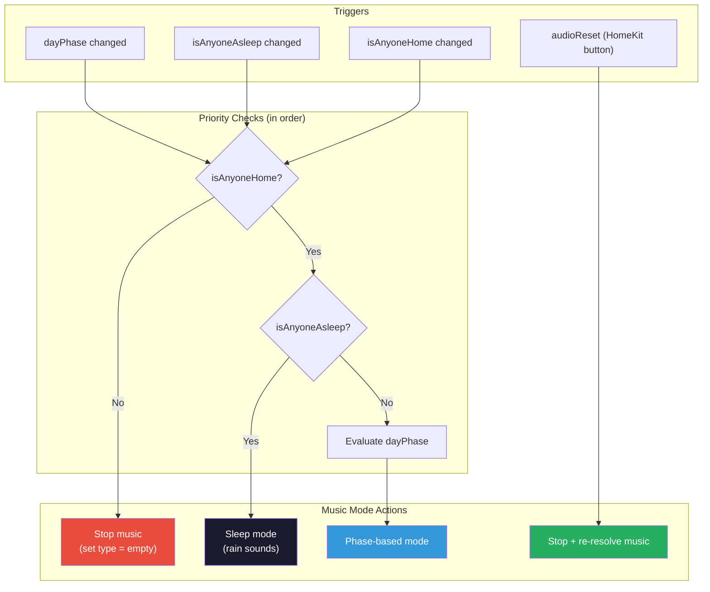
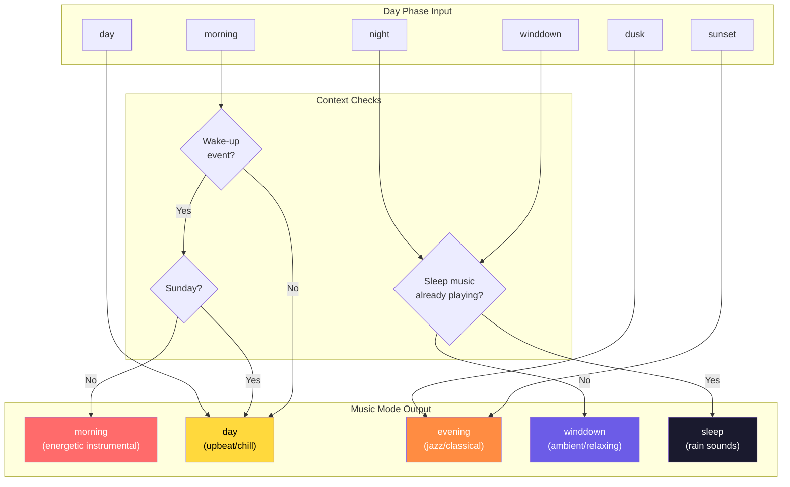
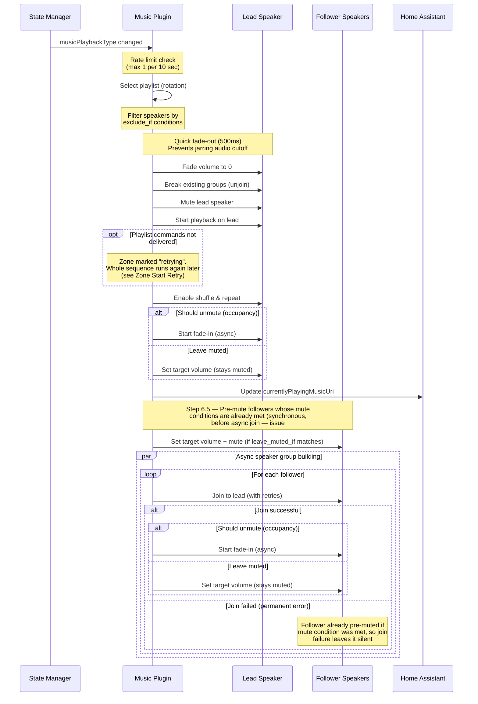
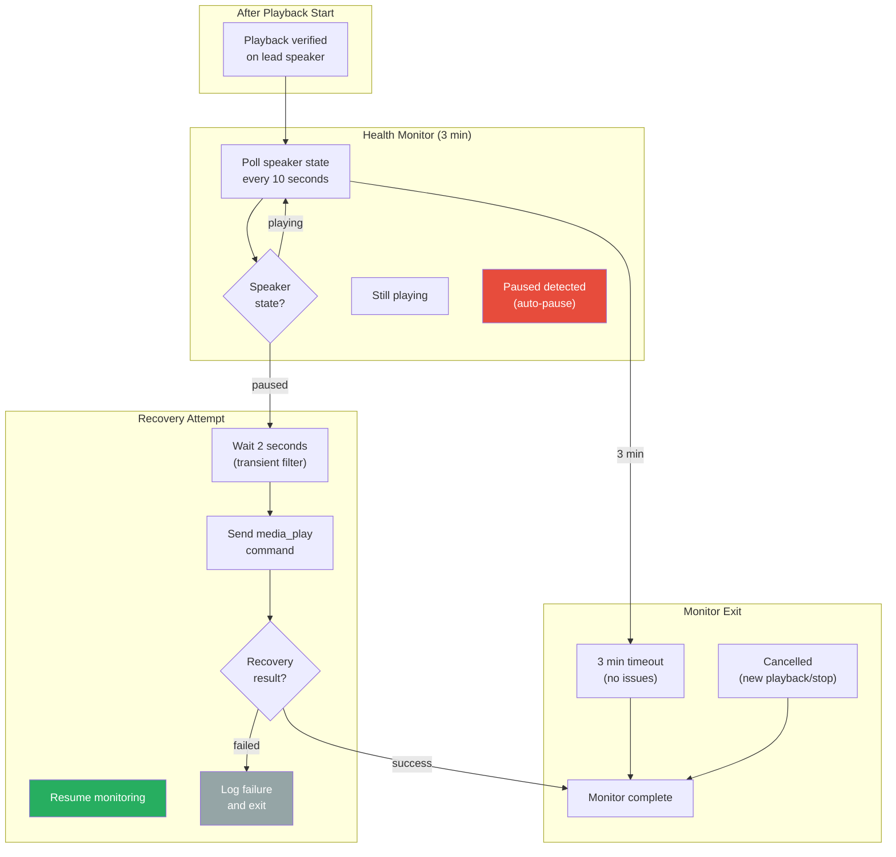
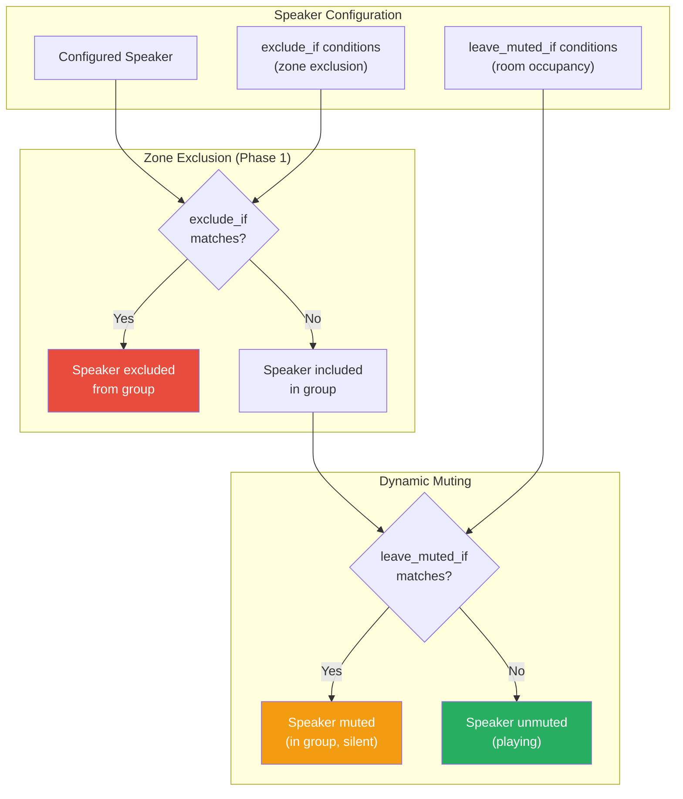
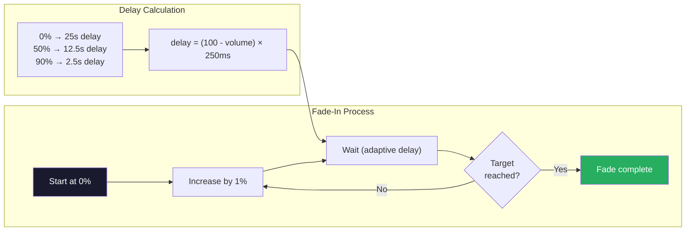
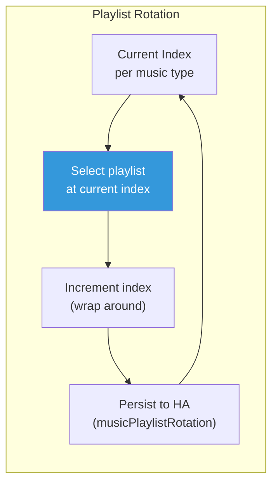

# Music Playback Flow

This document describes the music playback automation flow, which manages whole-home audio based on day phase, sleep state, and room occupancy.

## Control and Evidence Authority

When `SOCO_CLI_URL` is configured, SoCo-CLI is the command path for Sonos and the read path for current volume,
playback status, and startup reconciliation. It talks to speakers directly through UPnP. Home Assistant is still used
for automation inputs and persistent helpers. Its media-player state is corroborating evidence for this path, not the
result of a SoCo-CLI command. Without `SOCO_CLI_URL`, speaker commands and reads fall back to Home Assistant.

Use `/api/shadow/music` to see the mode, selected playlist, participants, and the automation's latest orchestration
state. Use application and SoCo-CLI logs to establish command results and playback verification. In particular, a
Home Assistant media-player entity that is `unavailable` does not override a contemporaneous successful SoCo-CLI
verification. See [Current Behavior and Authority](../CURRENT_BEHAVIOR.md) for the system-wide diagnostic model.

## Overview

The music plugin coordinates Sonos speaker playback by:
1. Selecting appropriate music mode based on day phase and sleep state
2. Building speaker groups with the right participants
3. Applying room-specific volume and mute conditions
4. Managing playlist rotation for variety

## Music Mode Selection



## Day Phase to Music Mode Mapping

The music mode is determined by the current day phase with additional context:



### Music Mode Details

| Music Mode | Day Phases | Playlist Style | Notes |
|------------|------------|----------------|-------|
| `morning` | morning (wake-up only) | Instrumental melodic house/techno, epic classical | Only plays on wake-up events; skipped on Sundays |
| `day` | morning (no wake-up), day | Kygo, chill tracks, soft house, country | Default daytime music |
| `evening` | sunset, dusk | Instrumental study, jazz, classical, chilled jazz | Calmer evening music |
| `winddown` | winddown, night | Floating through space, ambient relaxation | Pre-sleep relaxation |
| `sleep` | (triggered by sleep state) | Rain sounds | Triggered by isAnyoneAsleep, not day phase |
| `wakeup` | (alarm trigger) | Ambient relaxation | Gentle wake-up music (set by sleep hygiene plugin) |

An explicitly activated `sex` session owns the bedroom music selection while
`input_boolean.sex` remains on. Automatic day-phase selection and restoration of a
previous mode cannot replace that session, including while its zone start is retrying.
Turning `input_boolean.sex` off deliberately ends the override and restores normal
automatic selection.

## Playback Orchestration

When a music mode is selected, the following sequence executes. The key optimization is **async speaker grouping**: the lead speaker starts playing immediately while follower speakers join the group in the background.

On service startup, the plugin reconciles before orchestrating. With SoCo-CLI configured, it reads the lead speaker's transport state (`playback`), current track URI (`get_uri`), group (`groups`), and participant volumes from SoCo-CLI; otherwise it reads the lead's Home Assistant entity. If the lead speaker is playing a track that can be attributed to the selected mode's playlist pool — Tidal-shaped track URIs (`x-sonos-http:track…`) are accepted coarsely if the mode has a `tidal` PlaybackOption (because Sonos never reports the original sharelink, only an opaque resolved track URI); m3u playlists are fetched and checked for individual track membership (result cached for the Manager's lifetime); other media types fall back to exact URI match — and the Sonos group contains only desired zone speakers, the plugin adopts that playback into shadow state and skips the fade-out/regroup/play/fade-in sequence. Missing desired followers are tolerated and reflected as inactive in shadow; foreign group members or an unrecognised track fall back to normal orchestration. A paused lead is adopted the same way and stays paused: the running app never resumes a pause, so a restart does not either. The playback health monitor is not started for a paused adoption, because it would resume the speaker.



### Why Async Speaker Grouping?

The async approach provides faster perceived playback start:
- **Before**: Wait for all speakers to join group → then start playback (slower)
- **After**: Start playback on lead immediately → followers join in background (faster)

Followers that fail to join (e.g., speaker offline) are logged but don't block playback. Followers whose mute conditions were met at playback start are pre-silenced before the join attempt, so a join failure cannot leave them playing unmuted (issue #998).

A follower's join can wait minutes for its stagger and retry delays. Before each attempt, the plugin checks that
the speaker still belongs to a zone led by the same lead speaker. If a later zone resolution moved the speaker, for
example into the `sex` zone, the plugin drops the join. The old zone cannot pull the speaker back (issue #1477).

## Zone Start Retry

The lead speaker can stop answering at the moment a zone starts. On 2026-11-17, Pantry stopped answering for about
50 seconds when sleep-prep started. The playlist never loaded, and the house stayed silent all night.

When a command that loads or starts the playlist on the lead speaker fails, the plugin does this:

1. It stops the start sequence before the fade-in. It does not raise the volume on a speaker with nothing to play.
2. It marks the zone `retrying`. The music shadow state shows this as `activeZones[].playbackStatus`.
3. It waits 30 seconds, then 1 minute, then 2 minutes, then every 5 minutes. After each wait it runs the whole start
   sequence again.
4. It stops retrying when the zone ends or is replaced, or when the plugin stops.

A zone's `playbackStatus` is `starting` while its first start runs, and `playing` once the playlist commands were
delivered. A `retrying` zone is never handed to the next zone by a seamless transition, because it has no playback to
keep. The next zone starts in full instead.

This retry covers commands that could not be delivered. If the commands were delivered but the lead speaker does not
report `PLAYING`, the plugin still fades in. Sonos speakers at volume 0 sometimes report idle while playing
(2026-01-03 incident).

## Post-Playback Health Monitoring

After playback starts successfully, a health monitor watches for Sonos auto-pause events and attempts automatic recovery:



### Why Health Monitoring?

Sonos speakers occasionally auto-pause playback within the first few minutes, typically due to:
- Network hiccups during initial buffering
- Spotify connect handoff issues
- Speaker group synchronization problems

The health monitor provides resilience by:
1. **Single recovery attempt** - Prevents infinite retry loops
2. **Transient filtering** - 2-second delay avoids reacting to brief state flickers
3. **Bounded duration** - 3-minute window covers the typical auto-pause window
4. **Non-blocking** - Runs in background, cancels cleanly on new playback

### Shadow State Visibility

Monitor status is visible in the shadow state API (`/api/shadow/music`):

```json
{
  "outputs": {
    "playbackHealth": {
      "isMonitoring": true,
      "monitorStartTime": "2024-01-15T10:30:00Z",
      "monitorEndTime": "2024-01-15T10:33:00Z",
      "leadSpeaker": "media_player.living",
      "musicType": "day",
      "recoveryAttempted": false
    }
  }
}
```

## Speaker Zone Management

Speakers are filtered by `exclude_if` conditions at orchestration time, then muted/unmuted based on `leave_muted_if` conditions:



### Occupancy-Based Muting Example

```yaml
# From music_config.yaml - example using TV-based muting
participants:
  - player_name: "Sitting"
    base_volume: 9
    leave_muted_if:
      - variable: "isTVPlaying"
        value: true
```

When `isTVPlaying` changes from `true` to `false`:
1. Music plugin detects the mute condition variable change
2. Re-evaluates the speaker's mute conditions
3. Unmutes the Sitting speaker (already at target volume)

The Soundbar is configured in every playback zone that contains Kitchen, but its mute policy is independent:
Kitchen follows `isTVPlaying`, while the grouped Soundbar follows `isGuestAsleep`.
`isGuestAsleep` is true only when a guest is here (`isHaveGuests`) and asleep. With no guest, the Soundbar plays
even while the master sleeps.

## Volume Fade-In

Speakers fade in gradually to avoid sudden loud sounds:



### Human Override Detection

During fade-in, if the actual volume is significantly lower than expected (>2% difference), the system assumes a human manually lowered the volume and aborts the fade.

## Quick Fade-Out on Transitions

When playback mode changes or music stops, speakers perform a quick fade-out (500ms) before ungrouping or stopping. This prevents jarring audio cutoffs when:

- Switching between music types (e.g., day → evening)
- Stopping playback entirely
- Regrouping speakers for a new configuration

The fade-out uses 5 steps at 100ms intervals, smoothly reducing volume from current level to zero before any speaker group changes occur.

> **Note:** This is different from the gradual sleep music fade-out (5+ minutes) used during wake sequences. See [SLEEP_HYGIENE.md](./SLEEP_HYGIENE.md) for the wake sequence fade-out.

## Playlist Rotation

Playlists rotate to provide variety:



## Related Documentation

- [DAY_PHASE_MODES.md](./DAY_PHASE_MODES.md) - Day phase calculation and schedule configuration
- [SLEEP_HYGIENE.md](./SLEEP_HYGIENE.md) - Wake-up sequence and sleep music triggers
- [PLUGIN_SYSTEM.md](../reference/PLUGIN_SYSTEM.md) - Plugin architecture
- [SHADOW_STATE.md](../reference/SHADOW_STATE.md) - Shadow state pattern for debugging
