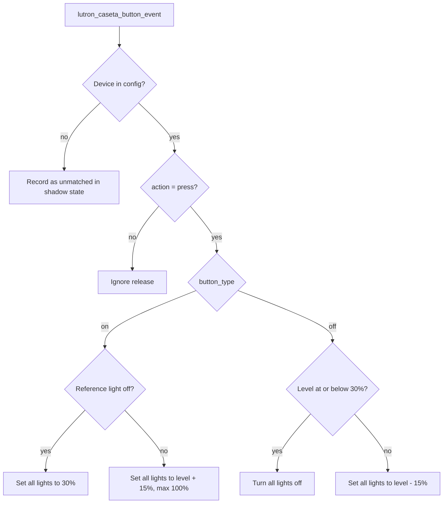

# Pico Buttons

Three Lutron Pico rockers in the pantry step the brightness of the pantry and kitchen lights.
The Picos control nothing inside Lutron. Home Assistant reports each press as a
`lutron_caseta_button_event`, and the `picos` plugin answers it.

## Which Pico does what

| Pico (Home Assistant device) | Where it is | Target | Lights stepped |
|------------------------------|-------------|--------|----------------|
| Pantry Primary Suite Door | By the primary suite door | pantry | `light.pantry_area`, `light.pantry_under_cabinet` |
| Pantry Pantry Lights Pico | In the pantry | pantry | same as above |
| Pantry Kitchen Lights Pico | In the pantry | kitchen | `light.kitchen_cans`, `light.kitchen_main_lights` |

The pantry Picos light the way for someone who walks into the pantry. The kitchen Pico lights the
next room for someone who walks on through. `light.pantry_area` is the Hue zone of the pantry cans
plus the hall light by the primary suite.

## What a press does



The first light of a target is the reference. The other lights are set to the same level.
Numbers come from `configs/pico_config.yaml` (`on_pct`, `step_pct`, `off_at_or_below_pct`).

From off, six up presses give 30, 45, 60, 75, 90, and 100%.
From 100%, down presses give 85, 70, 55, 40, and 25%. The next press turns the lights off.

## Fast presses

Hue and Lutron report a new level a moment after a command. A second press within
`recent_seconds` (5) steps from the level the plugin just sent. After that window it reads the
reference light again, so a change made in the Hue app is respected.

## Interaction with lux control

Kitchen and Pantry cans run under lux control (see [LUX_LIGHTING.md](./LUX_LIGHTING.md)). A Pico
press changes the cans to a level lux control did not send. Lux control sees a manual change and
holds the room. The hold ends when everyone is asleep or the house is empty.

The Pantry Primary Suite Door Pico targets both `light.pantry_area` and `light.pantry_under_cabinet`.
A press on `light.pantry_under_cabinet` triggers a **per-strip** follower hold, not a room hold. The
cans keep following the lux curve; only that strip is left alone. The strip hold clears with the same
events that end a room hold (everyone asleep, nobody home, or reset) — not by a Hue Sync takeover
(which only clears the cans command history, not the manual strip hold).

Lux control ignores a report that arrives within about 10 seconds of its own command. A press in
that window can be overwritten at the next lux tick.

## Behavior to know

- Turning on from off sends brightness only. Hue keeps its last color. Lutron has no color.
- `READ_ONLY=true` logs the press and sends nothing.
- A press in a room that the lighting plugin considers unoccupied lasts until the next occupancy
  change or the plugin's next off decision.

## Add or change a Pico

1. Press the new Pico.
2. Open `/api/shadow/picos`. `outputs.lastEvent.deviceId` shows its ID. `matched` is `false`.
3. Add it under `buttons:` in `configs/pico_config.yaml`.

## Debugging

```bash
curl -s https://home-automation.featherback-mermaid.ts.net/api/shadow/picos | jq
scripts/loki-query.sh '{service="home-automation"} | json | logger="picos"' 1h
```

`outputs.targets.<name>` shows the last press: levels before and after, the decision, and any error.
