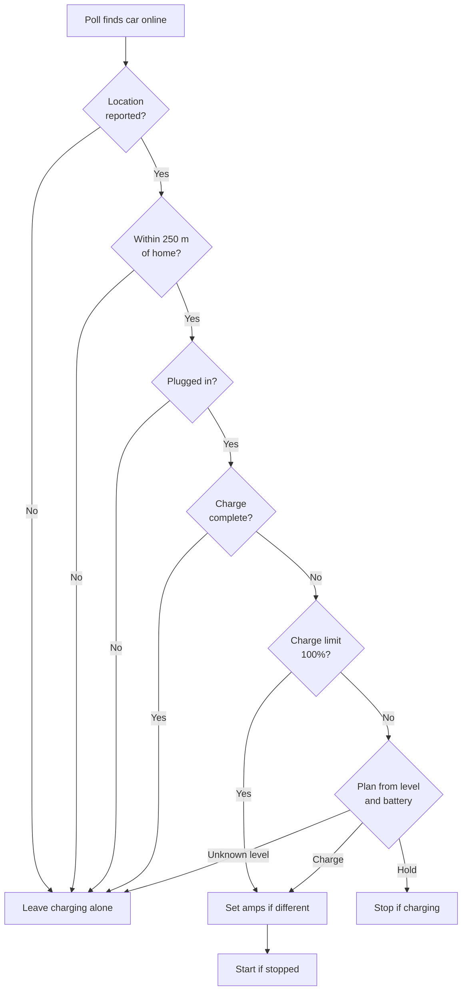
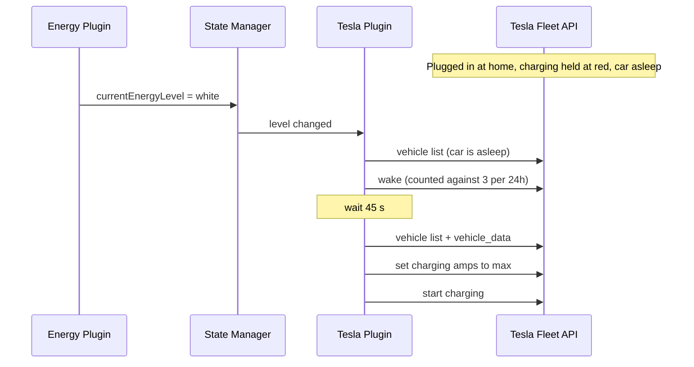

# Tesla Energy-Level Charging

The Tesla plugin can make the car's charging follow `currentEnergyLevel`. It acts only while the car is plugged in at home. It replaces Tesla's own "charge on solar" setting, which knows nothing about the house battery or the energy level.

This is always on when Tesla is configured and the home location is set. Turn off "charge on solar" in the Tesla app. If both are on, they fight over the charging speed.

## What Each Energy Level Does

| Energy level | Charging |
|--------------|----------|
| `red` | Stop |
| `yellow` | Stop |
| `green` | Charge slowly, at 8 A |
| `white` | Charge at full speed (the most the charger allows) |
| any level, battery below 50% | Charge at full speed |
| any level, charge limit set to 100% | Charge at full speed |
| unknown | Leave the car alone |

The plugin never changes the charge limit. The car stops at whatever limit is set in the Tesla app.

## Decision Flow

Each poll that finds the car online runs this check. A change in `currentEnergyLevel` triggers an immediate poll when the car was last seen plugged in at home.

## Override: Set the Charge Limit to 100%

When you need a full car, set the charge limit to 100% in the Tesla app. The plugin then ignores the energy level. It charges at full speed, and it restarts a charge it stopped earlier. Set the limit back below 100% to hand control back to the energy level.

The car stores the limit, so the override survives an app restart. The plugin sees the new limit at the next poll. Changing the limit in the Tesla app usually wakes the car, but the poll can still be up to `TESLA_POLL_MINUTES` away.

A manual change to the charging speed below 100% is not an override. The plugin sets the speed back on the next poll.

## Waking a Sleeping Car

A car that is not charging falls asleep. A sleeping car answers no data requests. So the plugin decides from what the last online poll saw.

The plugin wakes the car only when all of these are true:

- The car is `asleep`. An `offline` car cannot be woken.
- The last online poll saw it plugged in at home, below its charge limit.
- The energy level, the 50% floor, or a 100% charge limit now says charge.
- Fewer than 3 wakes happened in the last 24 hours.

After a wake, the plugin polls again 45 seconds later. That poll starts charging.

## Cost

Every command and wake is billed by Tesla. Commands go out only when the car's state differs from the plan. A steady energy level sends nothing.

## Requirements

- The home latitude and longitude in the application config.
- A token with the `vehicle_location` scope. Without it, Tesla reports no location and the plugin leaves charging alone.
- The virtual key paired with the car, as for any signed command.

`READ_ONLY=true` logs each command the plugin would send and sends none.

## Shadow State

`/api/shadow/tesla` shows the result of the last check:

| Field | Meaning |
|-------|---------|
| `atHome` | The last reported location is within 250 m of home |
| `chargeAmps` / `chargeAmpsMax` | Charging speed now, and the most the charger allows |
| `energyCharging.enabled` | Energy-level charging is on |
| `energyCharging.energyLevel` | The level the last check used |
| `energyCharging.decision` | What the last check decided, and why |
| `energyCharging.lastAction` | The last command sent, or that would have been sent in read-only mode |
| `energyCharging.wakesLast24h` | Wakes spent in the last 24 hours |

## Related Documentation

- [ENERGY_MANAGEMENT.md](./ENERGY_MANAGEMENT.md) - How `currentEnergyLevel` is calculated
- [LOAD_SHEDDING.md](./LOAD_SHEDDING.md) - The other consumer of `currentEnergyLevel`
