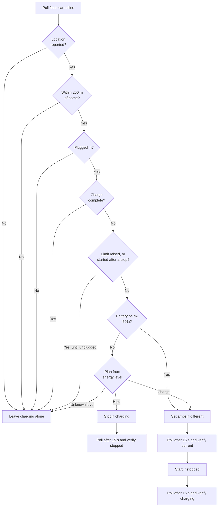
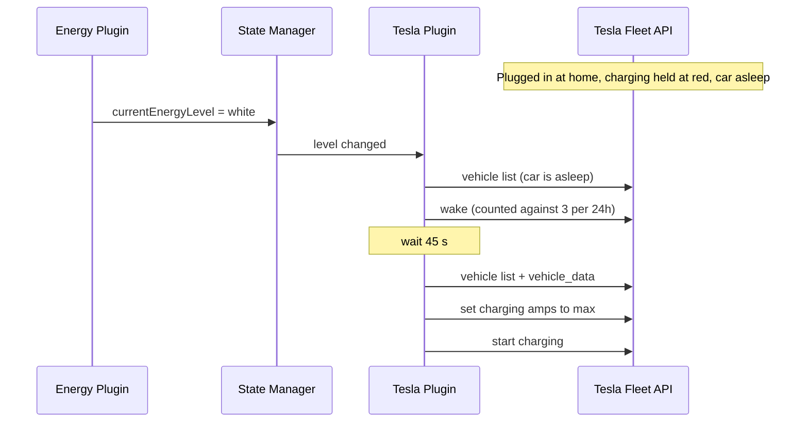

# Tesla Energy-Level Charging

The Tesla plugin can make the car's charging follow `currentEnergyLevel`. It acts only while the car is plugged in at home. It replaces Tesla's own "charge on solar" setting, which knows nothing about the house battery or the energy level.

This is always on when Tesla is configured and the home location is set. Turn off "charge on solar" in the Tesla app. If both are on, they fight over the charging speed.

## What Each Energy Level Does

Below 50%, the car charges at full speed regardless of energy level. At or above 50%, the energy level controls
charging:

| Energy level | Charging at or above 50% |
|--------------|--------------------------|
| `red` | Stop |
| `yellow` | Stop |
| `green` | Charge slowly, at 8 A |
| `white` | Charge at full speed (the most the charger allows) |
| unknown | Leave the car alone |

The plugin never changes the charge limit. The car stops at whatever limit is set in the Tesla app.

## Manual Override

You can take charging back from the plugin in the Tesla app. Do one of these while the car is plugged in at home:

- Raise the charge limit, for example from 80% to 100%.
- Start charging after the plugin stopped it.

The plugin then leaves charging alone until the car is unplugged or leaves home. It sends no stop, start, or speed
commands, and it does not wake the car. Shadow state shows `manualOverride: true` and the reason in `decision`.

Some actions do not count as an override:

- A high limit that was already set when the car arrived. The plugin compares against the limit it saw on the last poll
  at home.
- A car that still reports `Charging` just after a stop command. Tesla telemetry can lag, so a start counts only after a
  poll confirmed the car stopped.
- A restart of the app. The plugin forgets what it saw, so the next poll follows the energy level again.

The plugin polls at the normal interval during an override. It can take up to one interval to notice an unplug.

## Decision Flow

Each poll that finds the car online runs this check. A battery below 50% overrides the energy level and charges at full
speed. At 50% and above, red and yellow stop charging, green charges slowly, and white charges at full speed. A change
in `currentEnergyLevel` triggers an immediate poll when the car was last seen plugged in at home.

## Waking a Sleeping Car

A car that is not charging falls asleep. A sleeping car answers no data requests. So the plugin decides from what the last online poll saw.

The plugin wakes the car only when all of these are true:

- The car is `asleep`. An `offline` car cannot be woken.
- The last online poll saw it plugged in at home, below its charge limit.
- The energy level now says charge, or the battery is below 50%.
- No manual override is active.
- Fewer than 3 wakes happened in the last 24 hours.

After a wake, the plugin polls again 45 seconds later. That poll starts charging.

## Cost

Every command, wake, and poll is billed by Tesla. Commands go out only when the car's state differs from the plan. After a charging command, the plugin polls after 15 seconds and treats the command as pending until fresh telemetry agrees. Contradictory telemetry causes the policy command to be retried and verified again.

The normal poll interval defaults to five minutes. While charging or waiting for command verification, the plugin polls every minute (or the configured interval when it is already shorter). An online poll normally spends two Fleet API requests, so continuous charging costs about 120 requests per hour instead of about 24. The faster interval is limited to active charging and reconciliation; held, unplugged, and idle cars return to the normal interval.

## Requirements

- The home latitude and longitude in the application config.
- A token with the `vehicle_location` scope. Without it, Tesla reports no location and the plugin leaves charging alone.
- The virtual key paired with the car, as for any signed command.

`READ_ONLY=true` logs each command the plugin would send and sends none.

## Shadow State

`/api/shadow/tesla` shows the result of the last check:

| Field | Meaning |
|-------|---------|
| `atHome` | The last reported location is within 250 m of home |
| `chargeAmps` / `chargeAmpsMax` | Charging speed now, and the most the charger allows |
| `energyCharging.enabled` | Energy-level charging is on |
| `energyCharging.energyLevel` | The level the last check used |
| `energyCharging.batteryPercent` | Battery percentage used for the decision |
| `energyCharging.decision` | What the last check decided, and why |
| `energyCharging.plannedAction` | Charge, hold, or leave unchanged |
| `energyCharging.lastAction` | The last command sent, or that would have been sent in read-only mode |
| `energyCharging.commandResult` | Whether Tesla accepted or rejected the command; acceptance is not verification |
| `energyCharging.reconciliationStatus` | Pending or verified result of the latest telemetry reconciliation |
| `energyCharging.lastVerifiedVehicleState` | Battery, charging state, and current from the latest Fleet API read |
| `energyCharging.wakesLast24h` | Wakes spent in the last 24 hours |
| `energyCharging.manualOverride` | A person took control in the Tesla app. The plugin leaves charging alone until unplug |

## Related Documentation

- [ENERGY_MANAGEMENT.md](./ENERGY_MANAGEMENT.md) - How `currentEnergyLevel` is calculated
- [LOAD_SHEDDING.md](./LOAD_SHEDDING.md) - The other consumer of `currentEnergyLevel`
