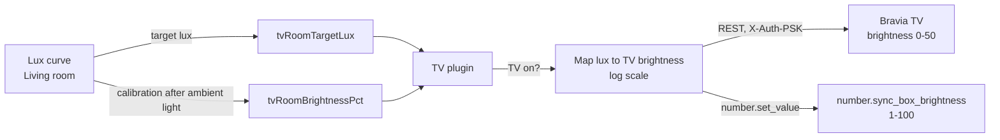

# TV and Hue Sync Brightness

**Status:** Built 2026-11-15; Hue Sync percentage mapping corrected 2026-11-16.

## Summary

The TV picture brightness and the Hue Sync box brightness follow the Living room's target lux. The target is the same lux curve the ceiling cans use ([LUX_LIGHTING.md](LUX_LIGHTING.md)). In the day both are bright. Through the evening both dim with the room.

This replaces the Node-RED flow, which set the TV to one of three fixed levels at day phase changes.

## How it works



1. The lighting plugin computes the Living target lux every minute. This includes `lux_scale` and the guest boost. It publishes the value as the local-only variable `tvRoomTargetLux`. It does this even while the room is in `skip` because Hue Sync owns the lights.
2. The TV plugin maps the target to a share between 0 and 1, on a log scale. 2.5 lux or less gives 0. 150 lux or more gives 1.
3. The TV gets `min + share × (max − min)`, using the range the TV reports. On the A80K that is 0 at night and 50 by day. The A80K picture is still easy to see at 0.
4. The lighting plugin converts needed lux (target minus estimated daylight) through the Living cans' calibration curve. It publishes that 0–100 output as `tvRoomBrightnessPct` even while Hue Sync causes the room to be skipped.
5. While `switch.sync_box_light_sync` is on, the sync box gets the same percentage, rounded to the nearest integer and clamped to its 1–100 range. Lighting owns this calculated value; the TV plugin only translates and sends it.

The TV and sync box mappings intentionally differ: the TV retains its log-scale picture mapping, while Hue Sync follows the active room curve percentage directly. For example, a calculated curve output of `34.5%` becomes Hue Sync brightness `35%`.

The plugin acts only while the TV is on (`media_player.sony_xr_65a80k`). It changes Hue Sync brightness only while light sync is active and never toggles light sync as part of a brightness update. It reads each device first and sends only changed values. The TV changes in steps of 1. The sync box changes in steps of at least 2.

## Turning on

When the TV turns on, the plugin waits 10 seconds. The Bravia API answers "not power-on" while the panel starts. Then it sets both devices to the current target.

## Display off while Home Assistant says the TV is on

The Bravia entity in Home Assistant can be stale. The plugin then tries the TV while its display is off. The TV answers error 40005: "not power-on" to a read, or "Display Is Turned off" to a write. Both mean the same thing. The plugin records the decision `TV screen not ready` and logs nothing above debug level. The next target change tries again.

## Manual changes

A person can change the TV brightness with the remote, or the sync box brightness in the Hue app. The plugin keeps that choice until the TV turns off and on again.

- Before each change, the plugin reads the device. If the value is not the last value it set, a person changed it. The plugin holds that device.
- The TV and the sync box are held separately.
- A picture mode change can also change the TV brightness. For example, Dolby Vision content uses its own picture mode. The plugin sees this as a manual change and holds the TV. This is on purpose: the plugin does not fight the TV.

## Setup

The TV brightness needs the TV's pre-shared key. Home Assistant's `braviatv` integration does not expose picture settings. So the app calls the TV's REST API directly: `POST http://<BRAVIA_IP>/sony/video` with `getPictureQualitySettings` and `setPictureQualitySettings`. These are the same calls as pybravia's `get_picture_setting` and `set_picture_setting`.

1. On the TV, set Settings > Network > Home Network Setup > IP Control > Pre-Shared Key.
2. Give the TV a fixed LAN address.
3. Set `BRAVIA_IP` and `BRAVIA_PSK` in the app's environment. See `homeautomation-go/.env.example` for quoting a key with special characters.
4. At startup, check the log line `TV brightness control enabled`. Its `psk_length` must match your key's length.

Without these variables, the sync box still follows the room, and the TV brightness is left alone.

Only one lux room may set `tv_room: true` in `hue_config.yaml`. The Living room sets it.

## Tuning

The constants are in `homeautomation-go/internal/plugins/tv/brightness.go`:

| Constant | Value | Meaning |
|----------|------:|---------|
| `BrightnessDarkLux` | 2.5 | Target at or below which both devices are at their dimmest |
| `BrightnessBrightLux` | 150 | Target at or above which both devices are at their brightest |
| `TVBrightnessDarkFraction` | 0 | TV's dimmest setting, as a share of its range. Set by eye on 2026-11-16 |
The two lux ends affect only the TV picture. Hue Sync uses the Living calibration curve directly.

## Shadow state

`/api/shadow/tv` shows the last decision in `outputs.brightness`:

| Field | Meaning |
|-------|---------|
| `trigger` | `target_lux` or `tv_power_on` |
| `targetLux`, `fraction` | The target and its share on the log scale |
| `decision` | `applied`, `TV off` or `no target lux yet` |
| `tv`, `syncBox` | Per device: `goal`, `current`, `held`, `heldReason`, `decision` |

## Debugging

```bash
scripts/loki-query.sh '{service="home-automation"} | json | logger="tv" |~ "(?i)brightness"' 6h
```
