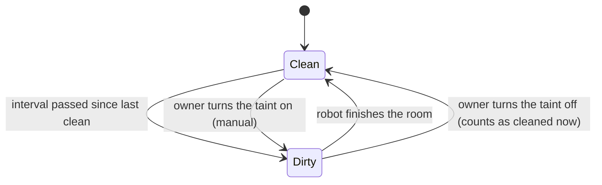
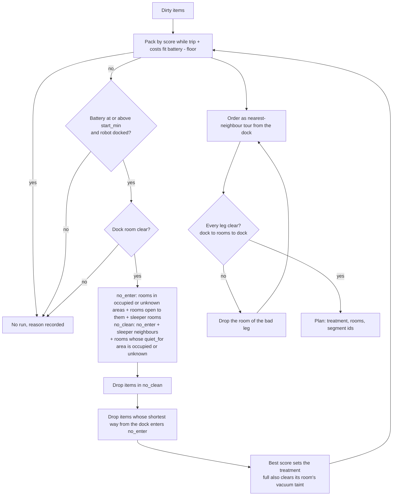
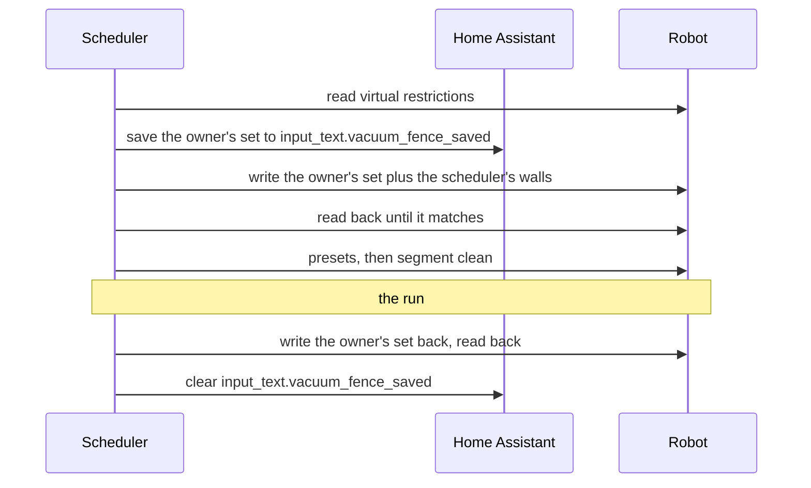
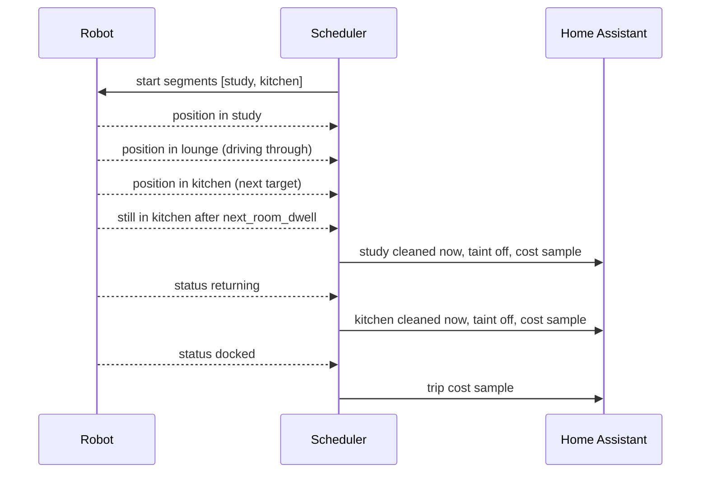
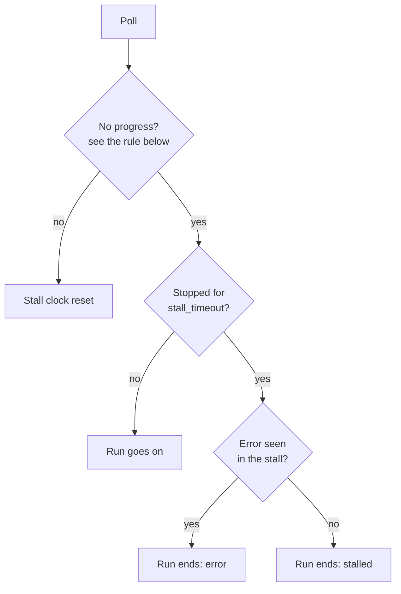
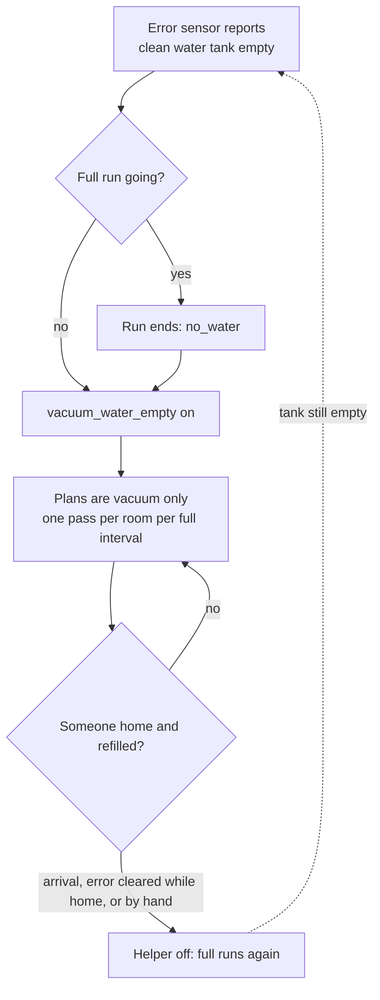
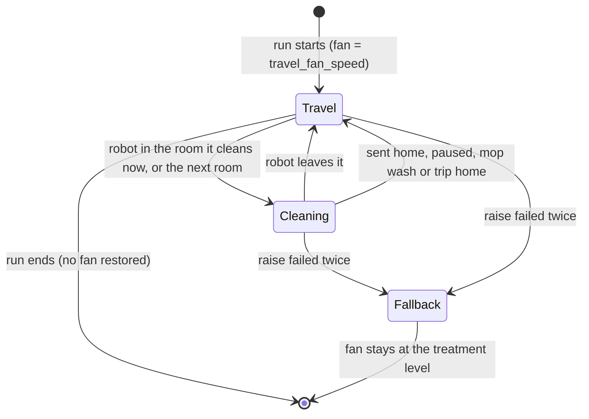
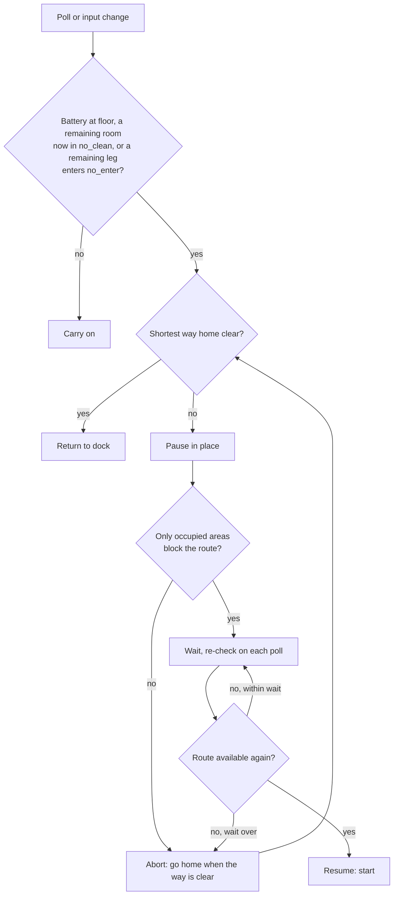

# Vacuum

The vacuum plugin (`homeautomation-go/internal/plugins/vacuum/`) does two things:

1. **Error announcer.** It speaks the robot's errors and repeats them until they clear. Errors play on
   `notification.default_speakers` (`configs/notification_config.yaml`), and so does the "You have satisfied
   Casper" confirmation. See
   [ARCHITECTURE.md](../architecture/ARCHITECTURE.md#15-vacuum-plugin-).
2. **Dirty-room scheduler.** It cleans rooms when they are dirty, available under room access constraints, and fit
   in the battery.

This page covers the scheduler. It is off unless `vacuum_config.yaml` sets `scheduler.mode`.

## Rules

Every rule must hold.

1. The robot never drives through a room where a person is. A room whose area room presence cannot see
   (cameras offline, or not published) counts as occupied. A sleeper's room counts as occupied too, whatever
   room presence says. Rooms joined by open passages (house map doors of kind `opening`) count as one room:
   when any room of such an open-plan region is occupied or unknown, the robot neither enters nor cleans any
   room of the region. The block spreads from opening to opening, so it covers the whole region. Doors do not
   spread it, and neither do exterior openings.
2. The robot never cleans a sleeper's room or a room one door away from it. It may drive through a room next
   to a sleeper.

   The robot also never cleans a room while an area within its earshot is occupied or unknown. A room lists those
   areas in `quiet_for`, by house-map area name, for example a pantry behind a door from the living area. The
   robot may drive through such a room, so rooms beyond it are still cleaned. The skip reason reads
   "within earshot of area living, which is occupied or unknown". An area name that is not in the house map
   stops the scheduler with a config error.
3. A run starts only at or above `battery.start_min` (70 % in the example). Rooms are packed so trip plus
   room costs stay within battery minus `battery.floor` (30 %). Costs are learned from real runs.

## Inputs and outputs

| Input | Source |
|-------|--------|
| Area occupancy | Room presence, through the occupancy hub (`pkg/occupancy`) |
| Sleepers | Boolean state variables named in `scheduler.sleepers` (for example `isMasterAsleep`) |
| Holds | Boolean state variables named in `scheduler.hold_while` (for example `isTVPlaying`) |
| Rooms, doors, frame | `house_map.yaml` (`internal/housemap`) |
| Battery, status, presets, position | Valetudo REST API (`internal/valetudo`) |
| Taints, last clean, costs | Home Assistant helpers, one set per room and treatment |

| Output | Where |
|--------|-------|
| Presets, segment clean, pause, return home, virtual walls | Valetudo REST API, `active` mode only |
| Taints, last clean, learned costs | Home Assistant helpers, `log_only` and `active` |
| Items, plan, skip reasons, run, robot room | `/api/shadow/vacuum`, under `scheduler` |
| The robot's area while it is out of the dock | Occupancy hub, in every mode. Room presence uses it to tell the robot from a person |

## Helpers

Each configured room has these helpers. A room with a `vacuum` interval has a second set with a `_vacuum`
suffix. A missing taint or last-clean helper is reported in shadow state and its item is skipped. A missing
cost helper is reported too, but the room is still cleaned with the floor-area guess: the cost helper only
stores what was learned.

| Helper | Meaning |
|--------|---------|
| `input_boolean.vacuum_dirty_<room>` | The room needs a full clean. Turn it on by hand to ask for one. |
| `input_datetime.vacuum_cleaned_<room>` | Last full clean. It survives restarts. |
| `input_number.vacuum_cost_<room>` | Learned battery percent for a full clean. |
| `input_number.vacuum_cost_trip` | Learned battery percent to drive out and back. A missing trip helper uses the default. |

One more helper keeps the owner's virtual walls and zones while the scheduler's walls are up (see
[Fencing](#fencing)). Create it as a text helper with maximum length 255. Without it, the scheduler warns and runs
without walls.

| Helper | Meaning |
|--------|---------|
| `input_text.vacuum_fence_saved` | The owner's virtual restrictions while scheduler walls are on the robot. Empty otherwise. Do not edit it. |

Another helper records that the mop dock is out of clean water (see [Out of water](#out-of-water)). Create it
as a toggle helper. Without it, the scheduler keeps the state in memory only, and a restart forgets it.

| Helper | Meaning |
|--------|---------|
| `input_boolean.vacuum_water_empty` | On while the clean water tank counts as empty. Runs are vacuum only. Turn it off by hand after a refill. |

## Taints

- A **full** clean vacuums and mops. It clears the full taint and the vacuum taint.
- A **vacuum** clean only vacuums. It clears the vacuum taint.
- Turning the full taint off by hand counts as a full clean, so it also clears the vacuum taint. Turning
  off only the vacuum taint clears only the vacuum taint.
- An item's score is time since clean divided by its interval. A manual taint scores at least 10. A room
  that was never cleaned scores 5.

## Planning

The planner (`planner.go`, `BuildPlan`) is a pure function. It runs every `replan_interval` and whenever an
input changes.

- Paths use the room graph from the house map: rooms joined by interior doors and openings, measured
  between door midpoints. A room that is not in `scheduler.rooms`, such as an open-plan link, can be driven
  through but is never cleaned.
- The robot plans its own route. So a leg is available only when its **shortest** way is clear. A longer available
  way does not count.
- Every dirty item left out gets a reason in `plan.skipped`.

## Start gate

The same plan must hold for `stable_for` (10 minutes) before it starts. Any change restarts the wait. The
plan's `startsAt` in shadow state shows when it will start.

### Hold while

`scheduler.hold_while` lists conditions on boolean state variables, in the same shape as the music and lighting
configs: `{variable: isTVPlaying, value: true}`. While any condition holds, no new run starts. The cleaning is
loud, so a deployment can hold runs while the TV plays.

- The plan has no rooms. Its reason, and every skipped item, says which variable holds, such as
  `held: isTVPlaying is true`.
- It is a start gate only. A run that is going goes on when a condition starts to hold.
- A change of a listed variable wakes the scheduler, so the plan updates at once. When the hold ends, the plan
  must hold for `stable_for` again before it starts.
- A variable that cannot be read, such as a name that is not a state variable or not a boolean, does not hold.
  `warnings` shows it.
- It works the same in `log_only`: the plan shows the hold, and no `wouldStartAt`.
- Without `hold_while`, nothing holds.

On start, the scheduler sets the treatment's presets (operation mode, fan speed, water grade) and then sends
one segment clean with `customOrder: true`. If a preset fails, nothing starts and the wait begins again. With
quiet travel on, the fan is set to `travel_fan_speed` instead (see [Quiet travel](#quiet-travel)).

In `log_only` mode, or when the app is read-only, it logs the run it would start and sends nothing. The plan
then shows `wouldStartAt` in shadow state until the plan changes.

## Fencing

The robot plans its own route. It may leave the planner's way, for example to get around a dog lying in a
doorway, and drive into a room a person is in. A Valetudo virtual wall is the one thing its path planner obeys.
So before a run starts, the scheduler puts a virtual wall across every door from a room the robot can reach into a
`no_enter` room. Fencing is on by default (`fence_no_enter: true`). Set `fence_no_enter: false` to turn it off.

- A wall goes across a house-map door or opening that joins a reachable room to a `no_enter` room. A room is
  reachable when a way from the dock gets to it without entering a `no_enter` room. Each wall reaches
  `fence_margin_m` (0.25 m) past both jambs. House metres become Valetudo centimetres with the inverse of the
  house map's `valetudo` frame.
- A door into a `no_enter` room with no span in the house map cannot be walled. It is shown in shadow
  warnings.
- The plan's way never enters a `no_enter` room, so walls around those rooms never cut it. The scheduler still
  checks: if a wall would cross a door on the way to any target or back, or fence in the dock room, the run does
  not start.
- If any step fails, the run does not start: the robot map does not fit the frame, the restrictions cannot be
  read, the owner's set does not fit in the helper, the helper cannot be written, the write fails, or the read
  back does not match. The owner's set is put back if walls went up. `warnings` shows why, and the start gate
  waits again.
- When nothing needs a wall, nothing is read or written.
- Right after Home Assistant starts, the helper can read `unknown` or `unavailable` before Home Assistant puts
  its saved value back, and a saved set read as empty could leave scheduler walls on the robot. So until the
  scheduler has read the helper once, no run starts. A text helper that was just created and never set stays
  `unknown` for good, so `unknown` only waits `fence_helper_grace` (default 2m). If it is still `unknown` after
  that, the scheduler treats it as empty: it takes away any wall that matches a scheduler door wall by geometry,
  keeps everything else, logs a warning, and writes an empty value to the helper so Home Assistant shows a real
  one. A failed write is logged and does not block. `unavailable` means Home Assistant or the integration is
  down, so it keeps blocking with no grace. While blocked, the plan's `reason` says why, for example
  `input_text.vacuum_fence_saved is unknown; waiting 1m20s more before treating it as empty`. Only an active,
  writable scheduler does this.
- When the run ends, for any reason, the owner's set goes back exactly and the helper is cleared. The robot's
  set is written only when it differs.
- A failed restore is tried again on every poll. No run starts while scheduler walls may still be on the robot.
  `fenceRestorePending` shows it.
- Walls are set only before a run. Valetudo itself lets restrictions change at any time: its Dreame code sends
  the firmware a `map_edit` action, and only the firmware's answer decides. What the firmware does with a change
  in the middle of a job is not known, so the scheduler never changes them then. People who move during the run
  are handled by [Live occupancy-aware routing](#live-occupancy-aware-routing).
- Valetudo answers a read from the map it polled last, and polls again after a change. So a change can show a
  few seconds late. The scheduler reads back up to ten times, one second apart.

### Restarts

- The saved set survives a restart in the helper. At startup, once no run is tracked, a saved set is put back.
  If the robot is on a job, such as the run from before the restart, its walls stay until that job ends.
- If the helper is empty at startup, every wall that matches a wall the scheduler would draw across a house-map
  door, to the centimetre, is taken away. Every other wall and every zone stays. So a lost save still leaves no
  scheduler wall behind. An owner's wall drawn exactly on a scheduler wall would be taken away too.
- A helper that is `unavailable` at startup is asked again on the next poll. Nothing starts until it was read.
  Later, an `unavailable` helper only stops a run that needs walls. `warnings` shows it.
- If the app stops during a run, the walls stay on the robot for the rest of that job.

## Tracking

Every `track_interval` (30 seconds) during a run, the scheduler reads the robot's position from the Valetudo
map. It turns the pixel into house metres with the house map's `valetudo` frame, then finds the room.

- A room is done when the robot leaves it for the next target and stays there. It is marked clean then. The
  last room is done when the run ends (see below), because heading to the dock may only be a mop wash.
- The first room of the tour counts at once. The next room after it counts once the robot has been in it for
  `next_room_dwell` (1 minute) without cleaning in the current room again. Near an open boundary, such as two
  rooms joined by an opening, the robot's position can fall into the next room for a poll or two while
  it still cleans the current room. Such a blip does not end the current room.
  - Going back to the current room while cleaning restarts the wait. Driving through it while not cleaning,
    such as on the way to a mop wash, does not.
  - Polls in no room or in a room that is not a target do not restart the wait.
  - Time not cleaning, such as a mop wash, does not count. The wait starts over when the robot cleans in the
    next room again.
  - If the run completes while the robot was cleaning in the next room, that room is done too, even if the
    wait was not over. A small last room needs this.
- Any other room counts only after the robot stays in it for `min_dwell` (2 minutes). This keeps a room the
  robot drives through from counting. `next_room_dwell` must not be longer than `min_dwell`.
- The battery drop between two polls goes to the room the robot was in at the first poll. Battery used at
  the dock — during a mid-job mop wash, a recharge or the final return — is left out, and so is battery used
  while the robot is stopped in `error`, `idle` or `paused`. A finished room's drop is its cost sample. The rest of the run's drop is the trip sample. Samples move the learned cost by
  `learning_rate` (0.3).
- Before any sample, a room's cost is its floor area times `default_cost_per_m2`.
- If the position cannot be trusted, the run is tracked without it. The position is not trusted when the
  house map has no `valetudo` frame, the pixel size differs, or the dock seems to have moved more than 0.5 m
  (the robot made a new map). Then the scheduler's own run marks every target done when it completes, and
  splits the battery drop beyond the trip by floor area.

### Dock visits in the middle of a job

A robot with a washing dock goes back to the dock during a job to wash its mop, and any robot may go back to
recharge. Valetudo keeps the status flag `resumable` while a job is in progress, whether the robot is docked,
returning, paused or idle. Its mop dock reports `DockStatusStateAttribute`, `cleaning` while it washes.

- A dock visit with the flag `resumable`, or while the dock is washing, is part of the run.
- The run ends when the robot is docked or idle with neither, for two polls in a row, or when it makes no
  progress for `stall_timeout` (see below).
- Only a cleaning robot moves through the tour. Time at the dock does not count as dwelling in the dock room.

### Stalled runs

A run that makes no progress for `stall_timeout` (30 minutes) ends. This covers a robot that stops with an
error, such as a full dust bag, and stays in it for hours. Without it, the next job would be folded into the
old run.

What counts as no progress:

- Status `error` always counts.
- Status `idle` or `paused` counts, even with the flag `resumable`. It does not count while the dock washes
  the mop, or after the live occupancy-routing rules paused the robot, while it waits for its return path to clear. A Dreame
  reports `idle`, not `paused`, after a pause, with the flag `resumable` or none. Both count as that pause.
- Status `docked` does not count, even with the flag `resumable`. A robot that goes back to recharge in the
  middle of a job stays docked with `resumable` until it has enough charge to go on, which can take hours. A
  docked robot with neither `resumable` nor a washing dock ends the run by the usual rule above. The one
  exception: once a stall began with an error, a docked robot keeps the clock running.
- `cleaning`, `returning` and `moving` are progress and reset the clock.

When a stalled run ends:

- The room the robot was in stays unfinished and dirty. Rooms it finished before stay finished.
- No trip cost is learned. Room samples already taken stand; no sample includes stopped time.
- The next `cleaning` starts a new run. A run started elsewhere reads its treatment from the operation mode
  at that time.
- `lastRun` shows the outcome, `error` or `stalled`, and `endReason`, such as
  `robot in error for 30m: status error, flag none`. The "Vacuum run ended" log line has the same `reason`.
- If it was the scheduler's own run, the scheduler plans again. A plan needs a docked robot, so nothing
  starts while the robot is still in error. The one exception is the water error (see [Out of water](#out-of-water)). Its first unfinished target is rotated behind other eligible
  targets. If it is the only eligible target, it remains dirty but waits another `stall_timeout` before the
  scheduler retries it. The rotation or deferral log includes the target, failure reason and retry time.

### Out of water

When the mop dock's clean water tank runs dry, the robot reports an error and cannot mop. The scheduler reads
the error sensor of the `vacuum:` section. When the error text contains `scheduler.water_empty_error`
(default `Clean Water Tank empty`, case ignored):

- A run that is not vacuum only ends at once as `no_water`. It does not wait for `stall_timeout`. Its current
  room stays dirty, and no target is rotated or deferred.
- `input_boolean.vacuum_water_empty` turns on, and every plan is vacuum only. A plan may start while the robot
  still reports the water error, because that error does not stop a vacuum-only run.
- A room due for a full clean gets one vacuum pass per `full` interval. The pass clears nothing: the room
  stays dirty for its full clean, and its last full clean time does not change. The skip reason shows when the
  next pass is due. A room with its own `vacuum` interval gets no extra pass: its vacuum taint covers it.

The robot gives no signal when someone refills the tank. So the helper turns off when:

- someone comes home (`isAnyoneHome` turns true),
- the water error changes to the no-error value while someone is home and no scheduler run is going, or
- someone turns it off by hand.

If the tank is still empty, the next full run hits the error again, ends at once, and the helper turns back on.

### Runs started elsewhere

A run started by a Valetudo timer, the app or the button is tracked the same way. Its rooms count after
`min_dwell`. The robot's operation mode decides what it clears: `vacuum_and_mop` clears both taints,
`vacuum` clears the vacuum taint, and `mop` clears nothing. The scheduler never commands such a run.

If the robot stopped (docked, idle, paused or in error) and then cleans again with a different operation
mode, that is a new job, such as another timer. The old run ends as `superseded`, with its current room
unfinished and no trip sample, and a new run starts with the new mode. This holds even within
`stall_timeout`.

## Quiet travel

The robot is loud when it drives between rooms at the cleaning fan speed. With `scheduler.travel_fan_speed`
set, such as `low`, the fan stays at that level while the robot travels. It goes up to the treatment's
`fan_speed` only while the robot is in the room it is cleaning now. The robot applies a fan change at once, in
the middle of a segment clean.

- It applies only to runs the scheduler starts in `active` mode. Runs started elsewhere are never touched. In
  `log_only` mode, or when the app is read-only, the "would start a run" log line names both fan speeds.
- The room being cleaned now is the run's current room. The fan is at the treatment's level in the current
  room and in the next room of the tour. In the next room, the robot is about to clean it, or is cleaning near
  its boundary with the current room, before `next_room_dwell` confirms the move. So a blip over the boundary
  does not change the fan, and a robot back in the current room keeps cleaning at the treatment's level. A
  later room of the tour, or any other room, keeps the fan low while the robot drives through. A room the
  robot stays in for `min_dwell` counts as being cleaned, as in tracking, so its fan goes up too.
- The fan is low while the robot is not cleaning: leaving the dock, a mop wash, after the live occupancy-routing rules
  sent it home or paused it, and the trip home at the end. After the run, no other fan level is restored. The
  next run sets its own.
- A fan command is sent only when the wanted level changes.
- While the robot travels, the robot is polled every `travel_track_interval` (5 seconds) so the fan goes up
  soon after it arrives. Otherwise `track_interval` applies. Every command still times out after 5 seconds.
- If the position cannot be trusted while the robot cleans, the fan goes to the treatment's level. A room is
  never cleaned at the travel level on purpose. Without a `valetudo` frame in the house map, quiet travel is
  off.
- If raising the fan fails, it is tried again on the next poll. If that fails too, the scheduler warns, stops
  switching for the rest of the run, and keeps setting the treatment's level until the robot takes it.
- If lowering the fan fails, the scheduler warns and the robot travels at the treatment's level. Cleaning goes
  on. Lowering is tried again on the next leg. If setting the travel level fails at the start, the run starts
  at the treatment's level.
- At startup, `travel_fan_speed` is checked against the robot's fan presets
  (`FanSpeedControlCapability/presets`; a Dreame L40 Ultra lists `low`, `medium`, `high`, `max`). A name the
  robot does not list turns quiet travel off with a warning. If the robot cannot be asked, it is asked again
  before the next run.
- A treatment without `fan_speed`, or with the same one as `travel_fan_speed`, does not switch.
- An empty `travel_fan_speed` turns quiet travel off. The run keeps the treatment's fan speed throughout.

## Live occupancy-aware routing

On every poll and on every occupancy or sleep change, the scheduler re-checks its own run.

- When the way home is clear, an unavailable route aborts the run at once and sends the robot home, as before.
- When the way home is blocked too, the robot pauses and the run waits. The cause must be an occupied area
  only: a sleeper's room or the battery floor aborts at once. A person who crosses the way for a few seconds
  costs a short pause, not the run.
  - If the whole route is available again within `route_blocked_wait` (default 5 minutes), the scheduler
    sends `start`. Valetudo resumes the job it paused and cleans the rooms that are left. The run goes on as
    one run and is not aborted.
  - If the route stays blocked past `route_blocked_wait`, the run aborts with the reason it had. A paused
    robot then goes home once its way is clear, and the unfinished rooms stay dirty.
  - A failed `start` is tried again on each poll until the wait is over.
- A paused robot of an aborted run goes home once the way clears. It does not resume the run.
- A remaining room enters `no_clean` when a sleeper falls asleep next door, or when an area in its `quiet_for`
  fills. Both end the run the same way, even while the robot is cleaning that room.
- A robot the scheduler paused is waiting for its way home, whether it reports `paused` or `idle`. That run never
  ends by stall, and an `idle` robot does not end it either. Only `error` still ends it after `stall_timeout`.
- A robot in a `no_enter` room has no available onward route at once, whether it went off the planned way or
  someone walked in.
- Every room change during a tracked run is logged ("Vacuum moved to another room"), with `on_route` for our own
  runs. A room that is neither on the planned way nor a target logs "Vacuum is off its planned route".
- From the dock to the first target, the robot is polled every `travel_track_interval` (5 seconds), so a robot
  that leaves the planned way is seen soon. A map read is about 75 KB.

### Stranded robot

With no run tracked, a robot that stands `idle` or `paused` away from the dock for `stranded_after` (5 minutes)
is sent home, if its shortest way home enters no `no_enter` room. Its room comes from the map, else from the last
run. A robot whose room is not known stays where it is, with a warning. If it still stands there
`stranded_after` later, it is sent home again. `error`, `docked`, `returning` and a washing dock are left alone.
Only `active` mode sends anything. This covers a run that ended while the robot was stopped, and a job someone
stopped by hand.
- Unfinished rooms stay dirty.
- Without a trusted position, the robot is assumed to be in the last room seen, or at the dock.

## Modes

| Mode | Plans | Tracks and learns | Writes helpers | Commands the robot |
|------|-------|-------------------|----------------|--------------------|
| `off` | no | no | no | no |
| `log_only` | yes | yes | yes | no |
| `active` | yes | yes | yes | yes, virtual walls included |

`READ_ONLY=true` blocks every write, helpers included, in every mode. The scheduler still plans and tracks in
memory, so shadow state shows what it would do.

In `log_only` mode, the "would start a run" log is followed by one "Vacuum would fence a no-enter room" line per
wall, with the door and the wall in Valetudo centimetres. Like a real start, it reads the robot map for its
pixel size and to check the frame. It never reads or writes the restrictions.

## Shadow state

`GET /api/shadow/vacuum` → `outputs.scheduler`:

| Field | Meaning |
|-------|---------|
| `configured`, `reason` | Whether the scheduler runs, and why not |
| `robot` | Status, battery, room, last poll, last error |
| `items` | Every room and treatment: dirty, manual, last clean, score, cost, missing helpers |
| `plan` | Latest plan, `noEnter`, `noClean`, `skipped` reasons, `pendingSince`, `startsAt`, `wouldStartAt` |
| `run`, `lastRun` | Origin, targets, done rooms, current room, pending next room, `pendingSince` (when the robot was first seen cleaning in the pending room), abort reason, paused, outcome (`completed`, `aborted`, `stopped`, `stalled`, `error`, `superseded`, `no_water`), `endReason` (why a run ended early), `quietTravel` (fan switching on for the run), `fanSpeed` (fan preset the scheduler last set), `fencedDoors` (doors walled off for the run) |
| `fenceRestorePending` | Scheduler walls may still be on the robot. No run starts until the owner's set is back |
| `waterEmpty` | The clean water counts as empty. Plans are vacuum only |
| `tripCost` | Learned trip cost |
| `warnings` | Missing helpers, untrusted position, unreadable sleepers, fan presets that failed or are not valid, fencing problems, a stranded robot that cannot go home |

## Configuration

See the `scheduler:` section of `configs/vacuum_config.yaml`. A problem in that section is reported in
shadow state. It never stops the error announcer.

## Known limits

- The room graph is an approximation of the robot's own path planner. Two routes of almost equal length may
  be chosen differently by the robot.
- The end-of-run rule relies on Valetudo's `resumable` flag and the dock status, as Valetudo's Dreame code
  sets them. A robot that goes to the dock in the middle of a job without either, and stays there for two
  polls, ends the run early. Its current room then counts as done. Check this during the `log_only` period.
- A robot in `error` for less than `stall_timeout` keeps its run open, so a stuck robot that is freed and
  resumes soon is still the same run. One freed later is a new run. If that was the scheduler's own run, the
  resumed job is watched as a run started elsewhere: the live occupancy-routing rules no longer apply to it.
- A run started elsewhere is split when the reported operation mode differs after a stop. A robot that
  reported another mode while it washed its mop would split one job into two; its current room stays dirty.
- The times of vacuum passes made while out of water are kept in memory. After a restart, each room due for a
  full clean gets one more vacuum pass.
- A sticky room presence token can block rooms for hours. The skip reasons show it.
- Walls are only as good as the house map's door spans and the `valetudo` frame. A frame off by more than
  `fence_margin_m` can leave a gap at a jamb.
- Walls are set from the occupancy at the start. A room that becomes `no_enter` during the run has no wall. If
  the robot ends up inside a walled room anyway, the walls keep it from leaving, so it cannot obey `home`. The run
  then ends by stall after `stall_timeout`, the walls come off, and the robot is sent home as a stranded robot.
