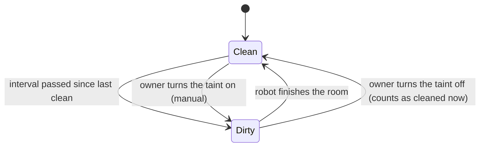
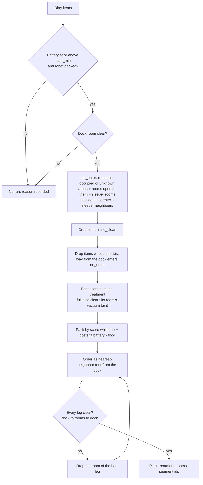
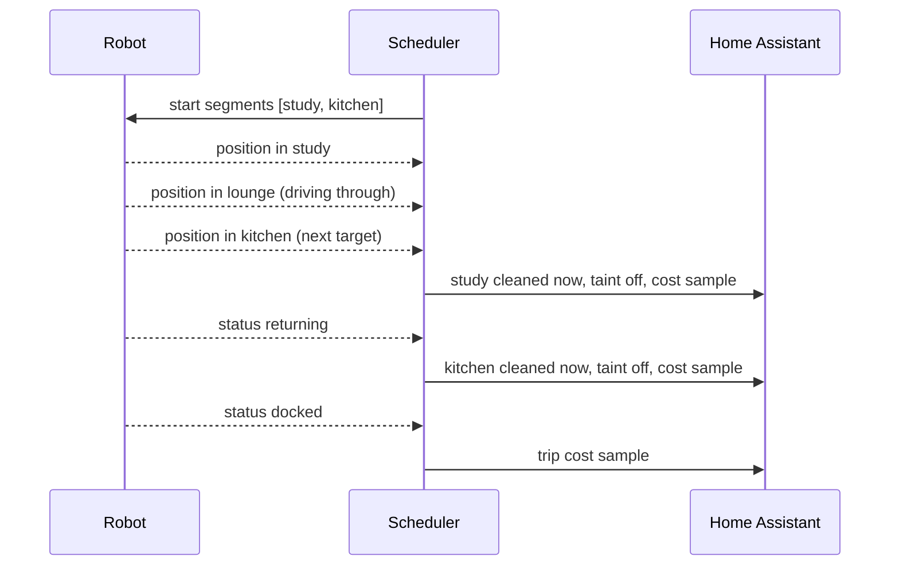
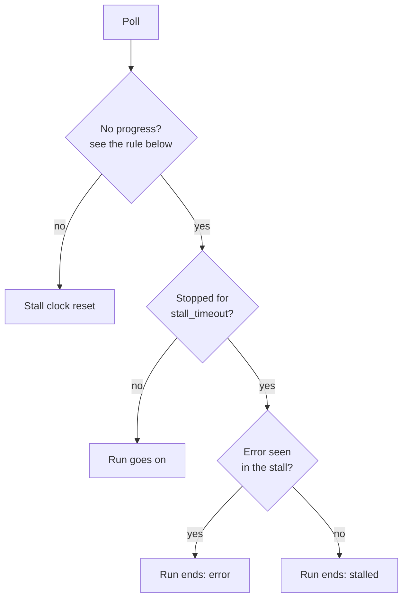
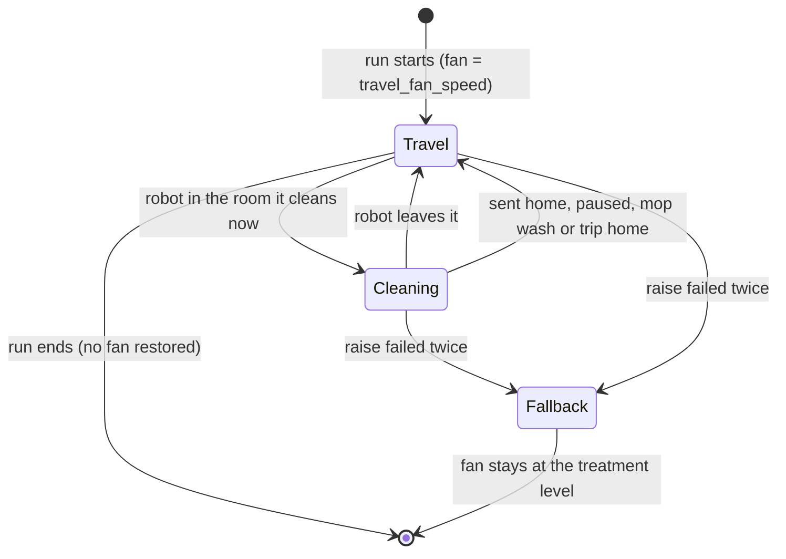
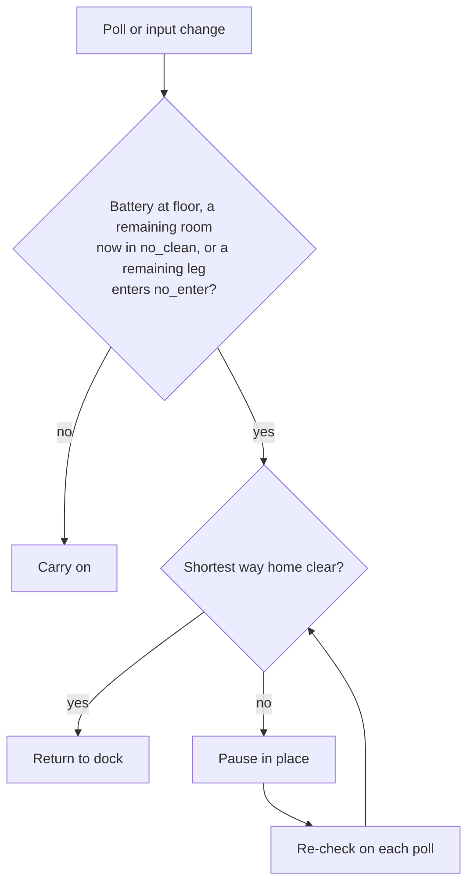

# Vacuum

The vacuum plugin (`homeautomation-go/internal/plugins/vacuum/`) does two things:

1. **Error announcer.** It speaks the robot's errors and repeats them until they clear. See
   [ARCHITECTURE.md](../architecture/ARCHITECTURE.md#15-vacuum-plugin-).
2. **Dirty-room scheduler.** It cleans rooms when they are dirty, safe to clean, and fit in the battery.

This page covers the scheduler. It is off unless `vacuum_config.yaml` sets `scheduler.mode`.

## Rules

Every rule must hold.

1. The robot never drives through a room where a person is. A room whose area room presence cannot see
   (cameras offline, or not published) counts as occupied. A sleeper's room counts as occupied too, whatever
   room presence says. Rooms joined by open passages (house map doors of kind `opening`) count as one room:
   when any room of such an open-plan region is occupied or unknown, the robot neither enters nor cleans any
   room of the region. The block spreads from opening to opening, so it covers the whole region. Doors do not
   spread it, and neither do exterior openings.
2. The robot never cleans a sleeper's room or a room one door away from it. It may drive through a room next
   to a sleeper.
3. A run starts only at or above `battery.start_min` (70 % in the example). Rooms are packed so trip plus
   room costs stay within battery minus `battery.floor` (30 %). Costs are learned from real runs.

## Inputs and outputs

| Input | Source |
|-------|--------|
| Area occupancy | Room presence, through the occupancy hub (`pkg/occupancy`) |
| Sleepers | Boolean state variables named in `scheduler.sleepers` (for example `isMasterAsleep`) |
| Rooms, doors, frame | `house_map.yaml` (`internal/housemap`) |
| Battery, status, presets, position | Valetudo REST API (`internal/valetudo`) |
| Taints, last clean, costs | Home Assistant helpers, one set per room and treatment |

| Output | Where |
|--------|-------|
| Presets, segment clean, pause, return home | Valetudo REST API, `active` mode only |
| Taints, last clean, learned costs | Home Assistant helpers, `log_only` and `active` |
| Items, plan, skip reasons, run, robot room | `/api/shadow/vacuum`, under `scheduler` |

## Helpers

Each configured room has these helpers. A room with a `vacuum` interval has a second set with a `_vacuum`
suffix. A missing taint or last-clean helper is reported in shadow state and its item is skipped. A missing
cost helper is reported too, but the room is still cleaned with the floor-area guess: the cost helper only
stores what was learned.

| Helper | Meaning |
|--------|---------|
| `input_boolean.vacuum_dirty_<room>` | The room needs a full clean. Turn it on by hand to ask for one. |
| `input_datetime.vacuum_cleaned_<room>` | Last full clean. It survives restarts. |
| `input_number.vacuum_cost_<room>` | Learned battery percent for a full clean. |
| `input_number.vacuum_cost_trip` | Learned battery percent to drive out and back. A missing trip helper uses the default. |

## Taints

- A **full** clean vacuums and mops. It clears the full taint and the vacuum taint.
- A **vacuum** clean only vacuums. It clears the vacuum taint.
- Turning the full taint off by hand counts as a full clean, so it also clears the vacuum taint. Turning
  off only the vacuum taint clears only the vacuum taint.
- An item's score is time since clean divided by its interval. A manual taint scores at least 10. A room
  that was never cleaned scores 5.

## Planning

The planner (`planner.go`, `BuildPlan`) is a pure function. It runs every `replan_interval` and whenever an
input changes.

- Paths use the room graph from the house map: rooms joined by interior doors and openings, measured
  between door midpoints. A room that is not in `scheduler.rooms`, such as an open-plan link, can be driven
  through but is never cleaned.
- The robot plans its own route. So a leg is safe only when its **shortest** way is clear. A longer safe
  way does not count.
- Every dirty item left out gets a reason in `plan.skipped`.

## Start gate

The same plan must hold for `stable_for` (10 minutes) before it starts. Any change restarts the wait. The
plan's `startsAt` in shadow state shows when it will start.

On start, the scheduler sets the treatment's presets (operation mode, fan speed, water grade) and then sends
one segment clean with `customOrder: true`. If a preset fails, nothing starts and the wait begins again. With
quiet travel on, the fan is set to `travel_fan_speed` instead (see [Quiet travel](#quiet-travel)).

In `log_only` mode, or when the app is read-only, it logs the run it would start and sends nothing. The plan
then shows `wouldStartAt` in shadow state until the plan changes.

## Tracking

Every `track_interval` (30 seconds) during a run, the scheduler reads the robot's position from the Valetudo
map. It turns the pixel into house metres with the house map's `valetudo` frame, then finds the room.

- A room is done when the robot leaves it for the next target. It is marked clean at once. The last room is
  done when the run ends (see below), because heading to the dock may only be a mop wash.
- The next room of the tour counts at once. Any other room counts only after the robot stays in it for
  `min_dwell` (2 minutes). This keeps a room the robot drives through from counting.
- The battery drop between two polls goes to the room the robot was in at the first poll. Battery used at
  the dock — during a mid-job mop wash, a recharge or the final return — is left out, and so is battery used
  while the robot is stopped in `error`, `idle` or `paused`. A finished room's drop is its cost sample. The rest of the run's drop is the trip sample. Samples move the learned cost by
  `learning_rate` (0.3).
- Before any sample, a room's cost is its floor area times `default_cost_per_m2`.
- If the position cannot be trusted, the run is tracked without it. The position is not trusted when the
  house map has no `valetudo` frame, the pixel size differs, or the dock seems to have moved more than 0.5 m
  (the robot made a new map). Then the scheduler's own run marks every target done when it completes, and
  splits the battery drop beyond the trip by floor area.

### Dock visits in the middle of a job

A robot with a washing dock goes back to the dock during a job to wash its mop, and any robot may go back to
recharge. Valetudo keeps the status flag `resumable` while a job is in progress, whether the robot is docked,
returning, paused or idle. Its mop dock reports `DockStatusStateAttribute`, `cleaning` while it washes.

- A dock visit with the flag `resumable`, or while the dock is washing, is part of the run.
- The run ends when the robot is docked or idle with neither, for two polls in a row, or when it makes no
  progress for `stall_timeout` (see below).
- Only a cleaning robot moves through the tour. Time at the dock does not count as dwelling in the dock room.

### Stalled runs

A run that makes no progress for `stall_timeout` (30 minutes) ends. This covers a robot that stops with an
error, such as a full dust bag, and stays in it for hours. Without it, the next job would be folded into the
old run.

What counts as no progress:

- Status `error` always counts.
- Status `idle` or `paused` counts, even with the flag `resumable`. It does not count while the dock washes
  the mop, or while the robot is paused by the live-safety rules waiting for its way home to clear.
- Status `docked` does not count, even with the flag `resumable`. A robot that goes back to recharge in the
  middle of a job stays docked with `resumable` until it has enough charge to go on, which can take hours. A
  docked robot with neither `resumable` nor a washing dock ends the run by the usual rule above. The one
  exception: once a stall began with an error, a docked robot keeps the clock running.
- `cleaning`, `returning` and `moving` are progress and reset the clock.

When a stalled run ends:

- The room the robot was in stays unfinished and dirty. Rooms it finished before stay finished.
- No trip cost is learned. Room samples already taken stand; no sample includes stopped time.
- The next `cleaning` starts a new run. A run started elsewhere reads its treatment from the operation mode
  at that time.
- `lastRun` shows the outcome, `error` or `stalled`, and `endReason`, such as
  `robot in error for 30m: status error, flag none`. The "Vacuum run ended" log line has the same `reason`.
- If it was the scheduler's own run, the scheduler plans again. A plan needs a docked robot, so nothing
  starts while the robot is still in error.

### Runs started elsewhere

A run started by a Valetudo timer, the app or the button is tracked the same way. Its rooms count after
`min_dwell`. The robot's operation mode decides what it clears: `vacuum_and_mop` clears both taints,
`vacuum` clears the vacuum taint, and `mop` clears nothing. The scheduler never commands such a run.

If the robot stopped (docked, idle, paused or in error) and then cleans again with a different operation
mode, that is a new job, such as another timer. The old run ends as `superseded`, with its current room
unfinished and no trip sample, and a new run starts with the new mode. This holds even within
`stall_timeout`.

## Quiet travel

The robot is loud when it drives between rooms at the cleaning fan speed. With `scheduler.travel_fan_speed`
set, such as `low`, the fan stays at that level while the robot travels. It goes up to the treatment's
`fan_speed` only while the robot is in the room it is cleaning now. The robot applies a fan change at once, in
the middle of a segment clean.

- It applies only to runs the scheduler starts in `active` mode. Runs started elsewhere are never touched. In
  `log_only` mode, or when the app is read-only, the "would start a run" log line names both fan speeds.
- The room being cleaned now is the run's current room. The next room of the tour becomes current as soon as
  the robot enters it. A later room of the tour, or any other room, keeps the fan low while the robot drives
  through. A room the robot stays in for `min_dwell` counts as being cleaned, as in tracking, so its fan goes
  up too.
- The fan is low while the robot is not cleaning: leaving the dock, a mop wash, after the live-safety rules
  sent it home or paused it, and the trip home at the end. After the run, no other fan level is restored. The
  next run sets its own.
- A fan command is sent only when the wanted level changes.
- While the robot travels, the robot is polled every `travel_track_interval` (5 seconds) so the fan goes up
  soon after it arrives. Otherwise `track_interval` applies. Every command still times out after 5 seconds.
- If the position cannot be trusted while the robot cleans, the fan goes to the treatment's level. A room is
  never cleaned at the travel level on purpose. Without a `valetudo` frame in the house map, quiet travel is
  off.
- If raising the fan fails, it is tried again on the next poll. If that fails too, the scheduler warns, stops
  switching for the rest of the run, and keeps setting the treatment's level until the robot takes it.
- If lowering the fan fails, the scheduler warns and the robot travels at the treatment's level. Cleaning goes
  on. Lowering is tried again on the next leg. If setting the travel level fails at the start, the run starts
  at the treatment's level.
- At startup, `travel_fan_speed` is checked against the robot's fan presets
  (`FanSpeedControlCapability/presets`; a Dreame L40 Ultra lists `low`, `medium`, `high`, `max`). A name the
  robot does not list turns quiet travel off with a warning. If the robot cannot be asked, it is asked again
  before the next run.
- A treatment without `fan_speed`, or with the same one as `travel_fan_speed`, does not switch.
- An empty `travel_fan_speed` turns quiet travel off. The run keeps the treatment's fan speed throughout.

## Live safety

On every poll and on every occupancy or sleep change, the scheduler re-checks its own run.

- A paused robot goes home once the way clears. It does not resume the run.
- Unfinished rooms stay dirty.
- Without a trusted position, the robot is assumed to be in the last room seen, or at the dock.

## Modes

| Mode | Plans | Tracks and learns | Writes helpers | Commands the robot |
|------|-------|-------------------|----------------|--------------------|
| `off` | no | no | no | no |
| `log_only` | yes | yes | yes | no |
| `active` | yes | yes | yes | yes |

`READ_ONLY=true` blocks every write, helpers included, in every mode. The scheduler still plans and tracks in
memory, so shadow state shows what it would do.

## Shadow state

`GET /api/shadow/vacuum` → `outputs.scheduler`:

| Field | Meaning |
|-------|---------|
| `configured`, `reason` | Whether the scheduler runs, and why not |
| `robot` | Status, battery, room, last poll, last error |
| `items` | Every room and treatment: dirty, manual, last clean, score, cost, missing helpers |
| `plan` | Latest plan, `noEnter`, `noClean`, `skipped` reasons, `pendingSince`, `startsAt`, `wouldStartAt` |
| `run`, `lastRun` | Origin, targets, done rooms, current room, abort reason, paused, outcome (`completed`, `aborted`, `stopped`, `stalled`, `error`, `superseded`), `endReason` (why a run ended early), `quietTravel` (fan switching on for the run), `fanSpeed` (fan preset the scheduler last set) |
| `tripCost` | Learned trip cost |
| `warnings` | Missing helpers, untrusted position, unreadable sleepers, fan presets that failed or are not valid |

## Configuration

See the `scheduler:` section of `configs/vacuum_config.yaml`. A problem in that section is reported in
shadow state. It never stops the error announcer.

## Known limits

- The room graph is an approximation of the robot's own path planner. Two routes of almost equal length may
  be chosen differently by the robot.
- The end-of-run rule relies on Valetudo's `resumable` flag and the dock status, as Valetudo's Dreame code
  sets them. A robot that goes to the dock in the middle of a job without either, and stays there for two
  polls, ends the run early. Its current room then counts as done. Check this during the `log_only` period.
- A robot in `error` for less than `stall_timeout` keeps its run open, so a stuck robot that is freed and
  resumes soon is still the same run. One freed later is a new run. If that was the scheduler's own run, the
  resumed job is watched as a run started elsewhere: the live-safety rules no longer apply to it.
- A run started elsewhere is split when the reported operation mode differs after a stop. A robot that
  reported another mode while it washed its mop would split one job into two; its current room stays dirty.
- A sticky room presence token can block rooms for hours. The skip reasons show it.
