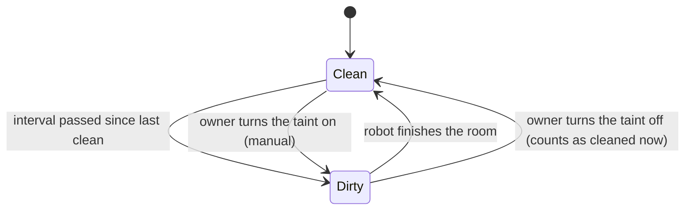
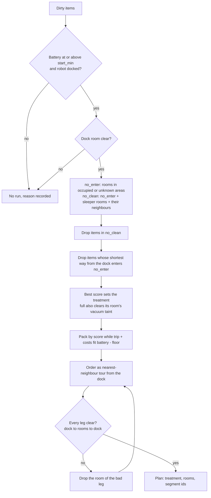
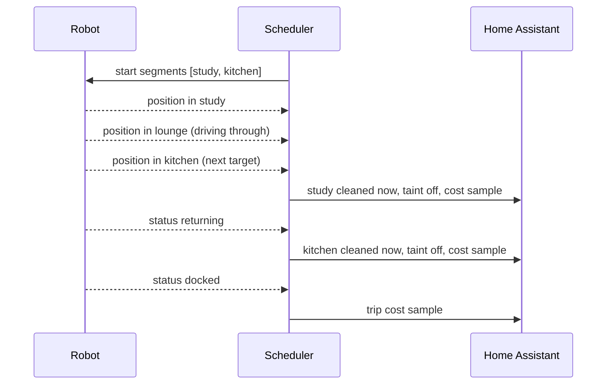
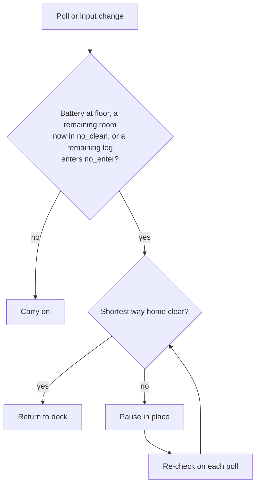

# Vacuum

The vacuum plugin (`homeautomation-go/internal/plugins/vacuum/`) does two things:

1. **Error announcer.** It speaks the robot's errors and repeats them until they clear. See
   [ARCHITECTURE.md](../architecture/ARCHITECTURE.md#15-vacuum-plugin-).
2. **Dirty-room scheduler.** It cleans rooms when they are dirty, safe to clean, and fit in the battery.

This page covers the scheduler. It is off unless `vacuum_config.yaml` sets `scheduler.mode`.

## Rules

Every rule must hold.

1. The robot never drives through a room where a person is. A room whose area room presence cannot see
   (cameras offline, or not published) counts as occupied.
2. The robot never cleans a sleeper's room or a room one door away from it. It may drive through a room next
   to a sleeper.
3. A run starts only at or above `battery.start_min` (70 % in the example). Rooms are packed so trip plus
   room costs stay within battery minus `battery.floor` (30 %). Costs are learned from real runs.

## Inputs and outputs

| Input | Source |
|-------|--------|
| Area occupancy | Room presence, through the occupancy hub (`pkg/occupancy`) |
| Sleepers | Boolean state variables named in `scheduler.sleepers` (for example `isMasterAsleep`) |
| Rooms, doors, frame | `house_map.yaml` (`internal/housemap`) |
| Battery, status, presets, position | Valetudo REST API (`internal/valetudo`) |
| Taints, last clean, costs | Home Assistant helpers, one set per room and treatment |

| Output | Where |
|--------|-------|
| Presets, segment clean, pause, return home | Valetudo REST API, `active` mode only |
| Taints, last clean, learned costs | Home Assistant helpers, `log_only` and `active` |
| Items, plan, skip reasons, run, robot room | `/api/shadow/vacuum`, under `scheduler` |

## Helpers

Each configured room has these helpers. A room with a `vacuum` interval has a second set with a `_vacuum`
suffix. A missing helper is reported in shadow state and its item is skipped.

| Helper | Meaning |
|--------|---------|
| `input_boolean.vacuum_dirty_<room>` | The room needs a full clean. Turn it on by hand to ask for one. |
| `input_datetime.vacuum_cleaned_<room>` | Last full clean. It survives restarts. |
| `input_number.vacuum_cost_<room>` | Learned battery percent for a full clean. |
| `input_number.vacuum_cost_trip` | Learned battery percent to drive out and back. A missing trip helper uses the default. |

## Taints

- A **full** clean vacuums and mops. It clears the full taint and the vacuum taint.
- A **vacuum** clean only vacuums. It clears the vacuum taint.
- An item's score is time since clean divided by its interval. A manual taint scores at least 10. A room
  that was never cleaned scores 5.

## Planning

The planner (`planner.go`, `BuildPlan`) is a pure function. It runs every `replan_interval` and whenever an
input changes.

- Paths use the room graph from the house map: rooms joined by interior doors and openings, measured
  between door midpoints. A room that is not in `scheduler.rooms`, such as an open-plan link, can be driven
  through but is never cleaned.
- The robot plans its own route. So a leg is safe only when its **shortest** way is clear. A longer safe
  way does not count.
- Every dirty item left out gets a reason in `plan.skipped`.

## Start gate

The same plan must hold for `stable_for` (10 minutes) before it starts. Any change restarts the wait. The
plan's `startsAt` in shadow state shows when it will start.

On start, the scheduler sets the treatment's presets (operation mode, fan speed, water grade) and then sends
one segment clean with `customOrder: true`. If a preset fails, nothing starts and the wait begins again.

In `log_only` mode, or when the app is read-only, it logs the run it would start and sends nothing.

## Tracking

Every `track_interval` (30 seconds) during a run, the scheduler reads the robot's position from the Valetudo
map. It turns the pixel into house metres with the house map's `valetudo` frame, then finds the room.

- A room is done when the robot leaves it for the next target, or heads home. It is marked clean at once.
- The next room of the tour counts at once. Any other room counts only after the robot stays in it for
  `min_dwell` (2 minutes). This keeps a room the robot drives through from counting.
- The battery drop between two polls goes to the room the robot was in at the first poll. A finished room's
  drop is its cost sample. The rest of the run's drop is the trip sample. Samples move the learned cost by
  `learning_rate` (0.3).
- Before any sample, a room's cost is its floor area times `default_cost_per_m2`.
- If the position cannot be trusted, the run is tracked without it. The position is not trusted when the
  house map has no `valetudo` frame, the pixel size differs, or the dock seems to have moved more than 0.5 m
  (the robot made a new map). Then the scheduler's own run marks every target done when it completes, and
  splits the battery drop beyond the trip by floor area.

### Runs started elsewhere

A run started by a Valetudo timer, the app or the button is tracked the same way. Its rooms count after
`min_dwell`. The robot's operation mode decides what it clears: `vacuum_and_mop` clears both taints,
`vacuum` clears the vacuum taint, and `mop` clears nothing. The scheduler never commands such a run.

## Live safety

On every poll and on every occupancy or sleep change, the scheduler re-checks its own run.

- A paused robot goes home once the way clears. It does not resume the run.
- Unfinished rooms stay dirty.
- Without a trusted position, the robot is assumed to be in the last room seen, or at the dock.

## Modes

| Mode | Plans | Tracks and learns | Writes helpers | Commands the robot |
|------|-------|-------------------|----------------|--------------------|
| `off` | no | no | no | no |
| `log_only` | yes | yes | yes | no |
| `active` | yes | yes | yes | yes |

`READ_ONLY=true` blocks every write, helpers included, in every mode. The scheduler still plans and tracks in
memory, so shadow state shows what it would do.

## Shadow state

`GET /api/shadow/vacuum` → `outputs.scheduler`:

| Field | Meaning |
|-------|---------|
| `configured`, `reason` | Whether the scheduler runs, and why not |
| `robot` | Status, battery, room, last poll, last error |
| `items` | Every room and treatment: dirty, manual, last clean, score, cost, missing helpers |
| `plan` | Latest plan, `noEnter`, `noClean`, `skipped` reasons, `pendingSince`, `startsAt` |
| `run`, `lastRun` | Origin, targets, done rooms, current room, abort reason, paused, outcome |
| `tripCost` | Learned trip cost |
| `warnings` | Missing helpers, untrusted position, unreadable sleepers |

## Configuration

See the `scheduler:` section of `configs/vacuum_config.yaml`. A problem in that section is reported in
shadow state. It never stops the error announcer.

## Known limits

- The room graph is an approximation of the robot's own path planner. Two routes of almost equal length may
  be chosen differently by the robot.
- A robot that goes home to recharge in the middle of a run started elsewhere may have its current room
  counted as done.
- A sticky room presence token can block rooms for hours. The skip reasons show it.
